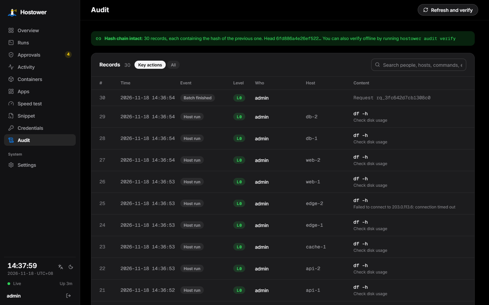

# Hostower

[简体中文](README.zh-CN.md) | [繁體中文](README.zh-TW.md) | [English](README.md) | [日本語](README.ja.md) | [한국어](README.ko.md) | [Français](README.fr.md) | **Deutsch**

**Ein selbst gehosteter Kontrollturm für Ihre Server.** Eine einzelne Person oder ein kleines Team sieht alle Hosts an einem Ort und kann auf ihnen handeln. Jede Änderung durchläuft eine deterministische Risikoprüfung und eine Genehmigung durch einen Menschen und hinterlässt einen überprüfbaren Audit-Nachweis.

Der Name setzt sich aus host + tower zusammen: Ein Leuchtturm sieht jedes Schiff auf dem Wasser und weist ihm den Weg.

Aktuelle Version: **v0.3.0** (siehe [CHANGELOG.en.md](CHANGELOG.en.md)). Solange keine externe Sicherheitsprüfung abgeschlossen ist, betreiben Sie Hostower in einem privaten Netzwerk oder hinter einem Reverse-Proxy, der Benutzer authentifiziert.

## So funktioniert es

Jeder Vorgang – ob aus der Weboberfläche, der Kommandozeile oder dem Chatbot – nimmt denselben Weg:

```
entry → gateway (authentication, origin check, rate limit) → security kernel: classify → approve → execute → audit → executor → host
```

| Stufe | Bedeutung | Beispiele | Behandlung |
| --- | --- | --- | --- |
| L0 | Nur lesen | `df -h`, `docker ps` | Wird automatisch ausgeführt |
| L1 | Änderung | Pakete installieren, Konfiguration bearbeiten, Dienste neu starten | Eine Genehmigung |
| L2 | Hohes Risiko | Daten löschen, Firewall oder sshd ändern, neu starten | Genehmigung in der Weboberfläche mit einem an Ort und Stelle bestätigten Passkey oder Authenticator-Code, dazu Eingabe des Hostnamens |
| L3 | Verboten | `rm -rf /`, Schreiben auf Blockgeräte, Lesen privater Schlüssel, `curl … \| sh` | Wird sofort abgelehnt; niemand kann es erlauben |

Die Stufe vergibt eine Regel-Engine: Ein Shell-Parser zerlegt Pipes, `&&`, Befehlsersetzungen und `sh -c` in einzelne Befehle, prüft jeden davon und nimmt die höchste Stufe. Befehle, die sich nicht parsen lassen oder unbekannt sind, gelten als L1. Das Verhalten der Engine ist durch eine [Testtabelle](internal/kernel/risk/testdata/table.txt) festgelegt.

## Funktionen

| Bereich | Was Sie bekommen |
| --- | --- |
| Hosts | Verwaltung über SSH, ohne etwas auf dem Host zu installieren; ein eingebauter lokaler Host (beim direkten Ausführen des Binärprogramms oder mit dem Host-Modus-Image); Hosts in der Oberfläche hinzufügen, bearbeiten, löschen und neu verbinden |
| Überwachung | Eine dauerhafte SSH-Verbindung pro Host, die alle 5 Sekunden eine Messung streamt: CPU, Speicher, Last, Datenträger-I/O, Netzwerk, Dateisystembelegung, Temperatur, Auslastung pro Container; Verlauf auf der Festplatte mit einstellbarer Aufbewahrungsdauer; ein optionaler erweiterter Collector ergänzt eine Prozessrangliste |
| Betrieb | Befehle mit gestreamter Ausgabe ausführen; Stapel, schrittweise Ausführung (rolling), Probeläufe, Abbruch bei Fehler; parametrisierte Snippets; ein interaktives Terminal (als L2 genehmigt, vollständig aufgezeichnet); Dateien durchsuchen, suchen, ansehen, bearbeiten, hochladen und herunterladen; Dateien auf mehrere Hosts verteilen und Dateien nach Namensmuster von mehreren Hosts einsammeln |
| Container und Apps | Container und Images verwalten, per Image bereitstellen oder aktualisieren, bei Registries anmelden; ein App-Katalog (Docker-Compose-Apps und npm-CLI-Tools, darunter OpenList, LiteLLM, Open WebUI und Ollama), der nach der Installation Zugriffsadresse, anfängliches Konto und erste Schritte nennt; für jeden Host prüfen, welchen Typ und Risikowert die Ausgangs-IP hat, ob er Modell-APIs wie OpenAI, Claude und Gemini nutzen kann, ob sich Websites wie Google, YouTube und Netflix öffnen lassen und in welcher Region, und welche KI-CLI-Tools installiert sind; Docker über die Oberfläche auf Hosts installieren, denen es fehlt |
| Zugangsdaten | SSH-Zugangsdaten, Registry-Anmeldungen und App-Geheimnisse zentral mit Envelope-Verschlüsselung gespeichert; überall sonst erscheint nur `ref:<name>` |
| Audit | Hash-Kette, Datenbank-Trigger gegen Manipulation, eine JSONL-Dateikopie, Offline-Prüfung; optional Archivieren und anschließendes Bereinigen |
| Anmeldung | Passkeys, Passwörter (optional mit Authenticator-Codes), OIDC-Single-Sign-On; L2-Genehmigungen erfordern eine erneute Bestätigung an Ort und Stelle |
| Benachrichtigungen und Chat | Telegram, Feishu/Lark, Discord, E-Mail; Telegram-Direktnachrichtenbefehle (Status, Einreichen, Notfallpause – niemals Genehmigen) |
| Geschwindigkeitstest | Latenz, Download und Upload, mit optionalen Traceroutes, die die Carrier-Route abschätzen (China Telecom CN2 GIA/GT, China Unicom 9929/4837, China Mobile CMIN2/CMI) |
| Bereitstellung | Ein einzelnes statisches Binärprogramm; ein Standard-Image und ein Host-Modus-Image; signierte Selbstaktualisierung |
| Oberfläche | Vereinfachtes Chinesisch, traditionelles Chinesisch, Englisch, Japanisch, Koreanisch, Französisch, Deutsch; helles und dunkles Design |

## Screenshots

Aufnahmen aus dem Entwicklungsmodus (simulierte Hosts), Oberfläche auf Englisch.

| **Übersicht: alle Hosts auf einen Blick** | **Host-Details: Live-Metriken** |
| --- | --- |
|  |  |
| **Ausführen: Risikovorschau vor dem Absenden** | **Genehmigung: an den exakten Befehl gebunden** |
|  |  |
| **Container: Auslastung und Update-Hinweise** | **App-Katalog** |
|  |  |
| **Audit: eine überprüfbare Hash-Kette** |  |
|  |  |

## Schnellstart

Auf einem Linux-Server mit Docker und Docker Compose v2 als root (oder mit einem sudo-Konto) ausführen:

```bash
bash <(curl -fsSL https://raw.githubusercontent.com/tsienwan/hostower/main/install.sh)
```

Für eine bestimmte Version hängen Sie deren Tag an (zum Beispiel `v0.3.0`):

```bash
bash <(curl -fsSL https://raw.githubusercontent.com/tsienwan/hostower/main/install.sh) v0.3.0
```

Für das Host-Modus-Image (verwaltet auch die eigene Maschine, läuft privilegiert) fügen Sie `--host` hinzu:

```bash
bash <(curl -fsSL https://raw.githubusercontent.com/tsienwan/hostower/main/install.sh) --host
```

Wenn Hostower hinter einem HTTPS-Reverse-Proxy läuft, geben Sie die öffentliche Adresse mit `--url` an:

```bash
bash <(curl -fsSL https://raw.githubusercontent.com/tsienwan/hostower/main/install.sh) --url https://hostower.example.com
```

Das Skript installiert nach `/opt/hostower` (änderbar mit `--dir`), lädt die Compose-Datei der gewählten Version, startet den Container und gibt URL, den Benutzernamen `admin` und das Initialpasswort aus. Ein erneuter Aufruf aktualisiert an Ort und Stelle und behält `data/`. Es lauscht nur auf `127.0.0.1`; SSH-Tunnel, HTTPS und Sicherungen siehe [Mit Docker bereitstellen](#mit-docker-bereitstellen).

Lieber das Skript lesen, bevor es als root läuft? Laden Sie es zuerst herunter:

```bash
curl -fsSLO https://raw.githubusercontent.com/tsienwan/hostower/main/install.sh
less install.sh
bash install.sh
```

## Mit Docker bereitstellen

Offizielle Images werden in der GitHub Container Registry für linux/amd64 und linux/arm64 veröffentlicht:

| Image | Verwendung |
| --- | --- |
| `ghcr.io/tsienwan/hostower:0.3.0` | Standard-Image: ohne root, schreibgeschütztes Root-Dateisystem, keine Shell. Verwaltet Hosts per SSH (auch die eigene Maschine, als gewöhnlicher SSH-Host hinzugefügt). Empfohlen. |
| `ghcr.io/tsienwan/hostower:0.3.0-host` | Host-Modus-Image: verwaltet zusätzlich die eigene Maschine als eingebauten Host `local`. Läuft privilegiert – Befehle auf dieser Maschine laufen als root. |

`0` und `latest` (bzw. `0-host` und `latest-host`) zeigen immer auf die neueste Version; legen Sie in Produktion eine genaue Version wie `0.3.0` fest.

### 1. Starten

```bash
mkdir -p ~/hostower && cd ~/hostower
curl -fsSLO https://raw.githubusercontent.com/tsienwan/hostower/main/deploy/compose.yaml
mkdir -p data config
sudo chown 65532:65532 data        # das Standard-Image läuft mit UID 65532 und muss in data/ schreiben können
docker compose up -d
```

Für das Host-Modus-Image verwenden Sie stattdessen `compose.host.yaml` (es läuft als root, `chown` ist nicht nötig):

```bash
curl -fsSLO https://raw.githubusercontent.com/tsienwan/hostower/main/deploy/compose.host.yaml
mkdir -p data config
docker compose -f compose.host.yaml up -d
```

### 2. Erste Anmeldung

```bash
sudo cat data/initial-password
```

Melden Sie sich mit diesem Passwort als `admin` unter <http://localhost:18443> an. Ändern Sie danach unter **Einstellungen → Sicherheit** das Passwort und fügen Sie einen Passkey oder Authenticator hinzu. Die Compose-Dateien lauschen nur auf `127.0.0.1`; auf einem entfernten Server öffnen Sie zuerst einen SSH-Tunnel und rufen dieselbe Adresse auf Ihrem Rechner auf:

```bash
ssh -L 18443:127.0.0.1:18443 user@your-server
```

### 3. Über HTTPS bereitstellen

Stellen Sie Hostower hinter einen Reverse Proxy, der TLS terminiert. Setzen Sie in `compose.yaml` `HOSTOWER_PUBLIC_URL` auf die öffentliche Adresse (zum Beispiel `https://hostower.example.com`), behalten Sie die Portfreigabe auf `127.0.0.1` und führen Sie `docker compose up -d` erneut aus. Mit Caddy ist das die gesamte Site-Konfiguration:

```
hostower.example.com {
    reverse_proxy 127.0.0.1:18443
}
```

### 4. Sichern und aktualisieren

- Sichern Sie das gesamte Verzeichnis `data/`: Es enthält Datenbank, Audit-Log und Hauptschlüssel. Schützen Sie die Sicherung so gut wie den Server selbst.
- **Einstellungen → Automatische Updates** aktualisiert Hostower nach Prüfung der Release-Signatur an Ort und Stelle. Um das Image zu wechseln, ändern Sie das Tag in der Compose-Datei und laden es neu.
- Sind alle Anmeldemethoden verloren, setzen Sie das Passwort des Eigentümers zurück und lesen Sie `data/initial-password` erneut.

```bash
docker compose pull && docker compose up -d
docker compose exec hostower /hostower auth reset-password   # schreibt ein neues Passwort nach data/initial-password
```

## Ausprobieren (Entwicklungsmodus)

Sie benötigen Go 1.26+ und Node 24+. Der Entwicklungsmodus berührt nie einen echten Rechner; er verwendet eingebaute simulierte Hosts.

```bash
cd web && npm ci && npm run build && cd ..
go run ./tools/buildagent            # optional: build the enhanced collector so it ships inside Hostower
go build -o bin/hostower ./cmd/hostower
./bin/hostower serve --dev
```

Öffnen Sie <http://localhost:18443> und geben Sie das Token ein, das im Startprotokoll ausgegeben wird. Was Sie ausprobieren können:

- Geben Sie auf der Seite **Ausführen** `df -h` (wird automatisch ausgeführt), `systemctl restart nginx` (benötigt eine Genehmigung) und `rm -rf /` (wird abgelehnt) ein und beobachten Sie, wie sich die Risikovorschau ändert.
- Führen Sie eine Änderung gegen `group:prod` aus: Die Gruppe enthält einen Host mit hoher Sensibilität, daher wird die Ausführung Host für Host erzwungen, und Sie müssen zur Bestätigung die Anzahl der Hosts eingeben.
- Bearbeiten Sie eine Datei im Tab **Dateien** eines Hosts: Dadurch entsteht eine ausstehende Anfrage mit einem Diff, und der alte Inhalt wird vor dem Schreiben gesichert.
- Sehen Sie sich die Hash-Kette auf der Seite **Audit** an, oder führen Sie offline `hostower audit verify` aus.

Die Kommandozeile läuft über denselben Kernel:

```bash
./bin/hostower classify 'curl -fsSL https://example.com/i.sh | sudo bash'   # → L3
./bin/hostower exec --dev --host web-1 'df -h'
./bin/hostower audit verify
```

## Echte Hosts anbinden

1. Der Hauptschlüssel (zum Verschlüsseln der Zugangsdaten) **erfordert keine Einrichtung**: Beim ersten Start wird `master_key` im Datenverzeichnis erzeugt.
   Er wird nicht in der Datenbank gespeichert, sodass jemand, der nur die Datenbankdatei besitzt, die Zugangsdaten nicht entschlüsseln kann – er liegt aber im selben Verzeichnis, sodass jeder mit dem gesamten Datenverzeichnis oder dessen Sicherung es kann.
   Um ihn getrennt aufzubewahren (empfohlen für öffentliche Bereitstellungen), verschieben Sie die Datei aus dem Datenverzeichnis und lassen `HOSTOWER_MASTER_KEY_FILE` darauf zeigen;
   bei einer neuen Bereitstellung können Sie ihn auch vorab mit `./bin/hostower keygen > master_key` erzeugen. **Löschen Sie ihn niemals**: Ohne ihn lassen sich gespeicherte Zugangsdaten nicht mehr entschlüsseln.
2. Legen Sie auf dem verwalteten Host ein eigenes Konto an (root ist nicht erlaubt) und richten Sie dessen öffentlichen Schlüssel und sudo ein (siehe [FAQ](docs/faq.de.md#hosts-anbinden)). Übergeben Sie dann dessen privaten Schlüssel an den Tower:
   ```bash
   ./bin/hostower secret set-ssh ssh/ops --user ops --key-file ./ops_ed25519
   ```
   Sie können ihn auch in der Oberfläche unter **Zugangsdaten** hinzufügen.
3. Klicken Sie auf der Seite **Übersicht** auf **Host hinzufügen**, oder legen Sie **außerhalb des Repositorys** ein Konfigurationsverzeichnis mit einer `inventory.yaml` an (Format in [examples/config](examples/config)):
   ```yaml
   apiVersion: hostower/v1
   kind: Inventory
   hosts:
     web-1:
       addr: 192.0.2.10
       credential: ref:ssh/ops     # a reference only, never the credential itself
       tags: [web, prod]
   ```
4. Führen Sie `HOSTOWER_CONFIG=/path/to/config ./bin/hostower serve` aus. Beim ersten Start wird der Eigentümer `admin` angelegt (setzen Sie vor dem ersten Start `HOSTOWER_ADMIN_USER`, um einen anderen Namen zu verwenden, oder benennen Sie ihn später unter **Einstellungen → Sicherheit** um). Das Anfangspasswort wird in `initial-password` im Datenverzeichnis geschrieben (Modus 0600, nie protokolliert; mit Docker: `sudo cat data/initial-password`). Ändern Sie nach der Anmeldung das Passwort und fügen Sie einen Passkey oder einen Authenticator hinzu. Wenn alle Anmeldemethoden verloren sind, führen Sie auf dem Server `hostower auth reset-password` aus.

Host-Schlüssel werden bei der ersten Verbindung als vertrauenswürdig übernommen und danach fest hinterlegt; bei einer Abweichung wird die Verbindung abgelehnt.

Häufige Probleme und Tipps zum Anbinden von Hosts, zu sudo, Docker und Apps finden Sie in den [FAQ](docs/faq.de.md).

## Bereitstellung

### Erreichbarkeit

In der Reihenfolge der Empfehlung:

1. **Nur lokaler Rechner oder privates Netzwerk** (Standard): lauscht auf `127.0.0.1:18443`.
2. **Hinter einem Reverse-Proxy oder Tunnel, der Benutzer authentifiziert**: `HOSTOWER_TLS=proxy`, `HOSTOWER_PUBLIC_URL=https://…`.
3. **Der Tower terminiert TLS selbst**: `HOSTOWER_TLS_CERT` / `HOSTOWER_TLS_KEY` (nur TLS 1.3).

Selbstprüfung beim Start: Lauscht der Tower auf einer Nicht-Loopback-Adresse ohne TLS oder wird der Entwicklungsmodus nach außen freigegeben, **verweigert der Tower den Start**, statt nur eine Warnung auszugeben.

### Drei Betriebsarten

- **Standard-Image** ([deploy/compose.yaml](deploy/compose.yaml)): ein einzelnes statisches Binärprogramm, keine Shell im Image, kein root, schreibgeschütztes Root-Dateisystem.
  Es sieht den Host-Rechner nicht; um diesen Rechner zu verwalten, legen Sie darauf ein eigenes Konto an und fügen ihn als gewöhnlichen SSH-Host hinzu. Beste Isolation.
- **Host-Modus-Image** ([deploy/compose.host.yaml](deploy/compose.host.yaml), `docker build --target host`):
  enthält von Haus aus einen `local`-Host. Der Preis: Der Container muss privilegiert laufen, und Befehle auf dem lokalen Host laufen als root auf dem Host-Rechner.
- **Binärprogramm direkt ausführen** (Beispiel in [deploy/hostower.service](deploy/hostower.service)): enthält ebenfalls den `local`-Host;
  Befehle laufen unter dem Konto, das Hostower ausführt, verwenden Sie daher ein eigenes Konto statt root und fügen Sie es der Gruppe `docker` hinzu, um Container zu verwalten. Setzen Sie `HOSTOWER_LOCAL=0`, wenn Sie ihn nicht benötigen.

Die Abwägungen sind im [Bedrohungsmodell](docs/threat-model.md) (Chinesisch) erläutert.

### Updates

Unter **Einstellungen** gibt es einen Schalter **Automatische Updates** (standardmäßig aus). Ist er eingeschaltet, prüft Hostower alle paar Stunden die Release-Seite, lädt eine neue Version herunter, prüft deren Release-Signatur und wechselt an Ort und Stelle darauf um.
Sie können ihn auch ausgeschaltet lassen und stattdessen auf **Nach Updates suchen** klicken. Alle drei Bereitstellungsarten funktionieren gleich; Container und Images bleiben unverändert.
Das funktioniert nur für offizielle Releases; ein selbst gebautes Binärprogramm hat keinen Release-Schlüssel, ersetzen Sie das Binärprogramm oder Image daher selbst.

Laden Sie nach einem Update bereits geöffnete Seiten vollständig neu (`Ctrl+F5`), damit die neue Oberfläche geladen wird.

## Dokumentation

| Dokument | Inhalt |
| --- | --- |
| [docs/faq.de.md](docs/faq.de.md) | FAQ: Hosts anbinden, sudo, Docker, der erweiterte Collector, Updates |
| [docs/design.md](docs/design.md) | Design (Chinesisch): Architektur, Sicherheitskernel, Messwerterfassung, Funktionsmodule |
| [docs/threat-model.md](docs/threat-model.md) | Bedrohungsmodell (Chinesisch): Vertrauensgrenzen, Bedrohungen und Gegenmaßnahmen, Abwägungen bei der Bereitstellung |
| [CHANGELOG.en.md](CHANGELOG.en.md) | Versionsverlauf |
| [CONTRIBUTING.en.md](CONTRIBUTING.en.md) | Mitwirken: Entwicklungsumgebung, Prüfungen vor dem Commit, Konventionen |
| [AGENTS.md](AGENTS.md) | Projektregeln (Chinesisch): Kernel-Invarianten, Kompatibilität, Repository-Hygiene, Mehrsprachigkeit, Versionierung – für Menschen und KI-Programmierassistenten gleichermaßen |
| [SECURITY.en.md](SECURITY.en.md) | Wie Sie Sicherheitsprobleme vertraulich melden |

## Projektstruktur

```
cmd/hostower/         main program and CLI (serve, classify, exec, audit verify…)
cmd/hostower-agent/   the optional enhanced collector
internal/kernel/      security kernel: classification (risk/), approval, execution, audit (audit/)
internal/gateway/     HTTP API, authentication, WebSocket
internal/executor/    executors: SSH, local, simulated hosts for development
internal/…            metrics, apps, notifications, speed test, credentials, storage and more
web/                  front end (React + TypeScript + Vite), embedded into the binary
tools/                developer tools: repository hygiene, i18n check, collector build, release signing
deploy/               deployment examples (Compose, systemd)
examples/config/      sample config directory (inventory, Snippets, rule packs)
docs/                 documentation
install.sh            Installationsskript für eine Zeile (siehe Schnellstart)
```

## Entwicklung

```bash
go test ./...                 # kernel, classification table, audit chain, modules
go run ./tools/hygiene        # repository hygiene: secrets, non-reserved IPs, non-example domains, files that must not be committed
go run ./tools/i18n           # missing translations
cd web && npm run dev         # front end with hot reload; start the tower with HOSTOWER_PUBLIC_URL=http://localhost:5173
```

Prüfungen vor dem Commit aktivieren:

```bash
git config core.hooksPath .githooks
```

Ändern Sie die [Testtabelle](internal/kernel/risk/testdata/table.txt), bevor Sie eine Einstufungsregel ändern. Die vollständigen Regeln stehen in [AGENTS.md](AGENTS.md) (Chinesisch); der Ablauf für Beiträge steht in [CONTRIBUTING.en.md](CONTRIBUTING.en.md).

### Arbeiten mit KI-Programmierassistenten

Die Projektregeln stehen an einer einzigen Stelle, [AGENTS.md](AGENTS.md) (Chinesisch), und alle drei unten genannten Werkzeuge lesen sie:

| Werkzeug | Wie es die Regeln liest |
| --- | --- |
| OpenAI Codex | Liest `AGENTS.md` direkt |
| DeepSeek Harness (dsh) | Liest `AGENTS.md` direkt (liest außerdem `CLAUDE.md`) |
| Claude Code | Liest `CLAUDE.md`, das dieselben Regeln mit `@AGENTS.md` einbindet |

Persönliche lokale Ergänzungen gehören in `AGENTS.local.md`, `CLAUDE.local.md` oder `AGENTS.override.md`; sie stehen in `.gitignore` und gelangen nie ins Repository.

## Repository-Hygiene

Das Repository enthält nur Code, allgemeine Beispiele und Dokumentation. Echte Inventare, Zugangsdaten und Bereitstellungsunterlagen liegen außerhalb davon.

- Beispiele verwenden nur reservierte Werte: `192.0.2.0/24`, `198.51.100.0/24`, `203.0.113.0/24`, `example.com` und Rollennamen wie `web-1`.
- `.gitignore` schließt `/config/`, `/data/`, Schlüssel, Datenbankdateien und Build-Ausgaben bereits aus.
- Der Pre-Commit-Hook und die CI führen beide `tools/hygiene` und `tools/i18n` aus.

## Bekannte Einschränkungen

- Die API ist einfaches HTTP/JSON unter `/api/v1`, bislang ohne Stabilitätszusage; es gibt eine einzige Rolle „Eigentümer“ und keine API-Tokens.
- Hostower erfasst und speichert seine eigenen Messwerte; es bindet weder Prometheus noch andere externe Überwachung an.
- Der Server gibt nur chinesische Ausgangstexte aus (das Audit-Protokoll ist nur erweiterbar, gespeicherter Text kann also nicht umgeschrieben werden); die Oberfläche übersetzt sie bei der Anzeige. Die Ausgabe der Kommandozeile ist Chinesisch.
- Zertifikate in den Panel-Einstellungen sind Dateipfade; sie werden nicht automatisch ausgestellt oder erneuert.
- Der Passkey-Ablauf wurde noch nicht durchgängig mit einem echten Authenticator überprüft.

## Lizenz

[AGPL-3.0-only](LICENSE). Die Regeln zur Verwendung des Projektnamens und Logos stehen in [TRADEMARKS.en.md](TRADEMARKS.en.md).
