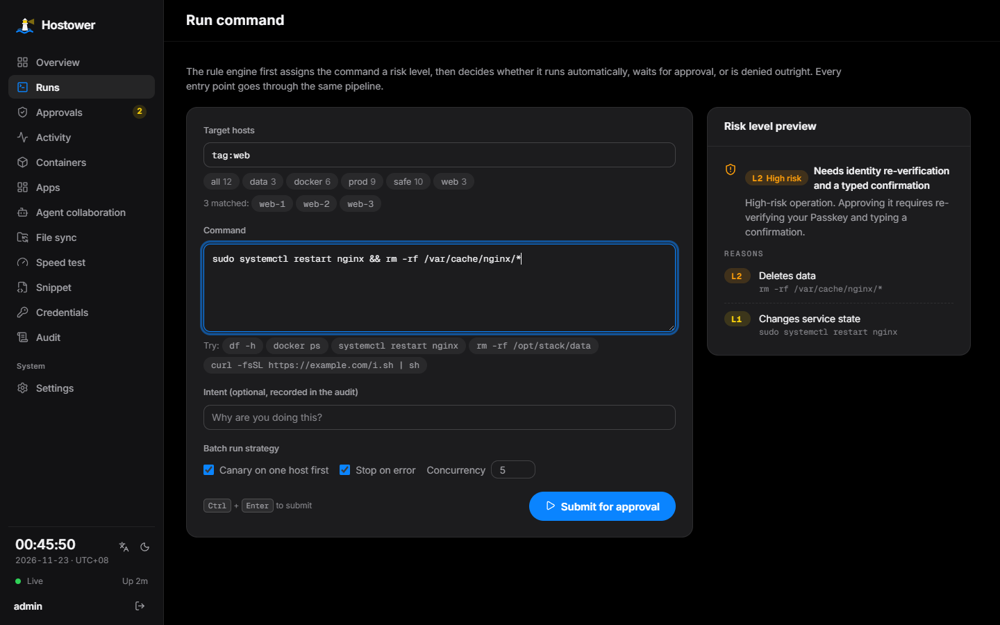
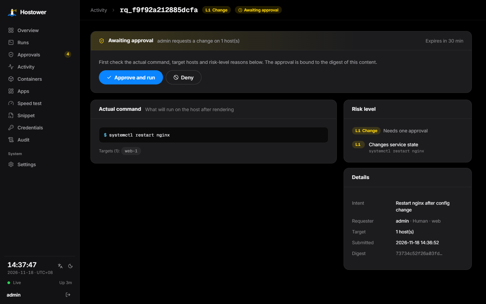

# Hostower

[简体中文](README.zh-CN.md) | [繁體中文](README.zh-TW.md) | [English](README.md) | [日本語](README.ja.md) | [한국어](README.ko.md) | **Français** | [Deutsch](README.de.md)

**Une tour de contrôle auto-hébergée pour vos serveurs.** Une personne seule ou une petite équipe voit tous ses hôtes au même endroit et agit sur eux. Chaque modification passe par une évaluation déterministe du risque et une approbation humaine, et laisse une piste d'audit vérifiable.

Le nom vient de host + tower : un phare voit chaque navire sur l'eau et le guide.

Version actuelle : **v0.3.0** (voir [CHANGELOG.en.md](CHANGELOG.en.md)). Tant que le projet n'a pas passé d'audit de sécurité externe, faites-le tourner sur un réseau privé ou derrière un proxy inverse qui authentifie les utilisateurs.

## Fonctionnement

Chaque opération — depuis l'interface web, la ligne de commande ou le bot de messagerie — suit le même chemin :

```
entrée → passerelle (authentification, vérification de l'origine, limitation de débit) → noyau de sécurité : classification → approbation → exécution → audit → exécuteur → hôte
```

| Niveau | Signification | Exemples | Traitement |
| --- | --- | --- | --- |
| L0 | Lecture seule | `df -h`, `docker ps` | Exécuté automatiquement |
| L1 | Modification | Installer des paquets, modifier la configuration, redémarrer des services | Une approbation |
| L2 | Risque élevé | Supprimer des données, modifier le pare-feu ou sshd, redémarrer l'hôte | Approbation dans l'interface web avec une Passkey ou un code d'authentification saisi sur le moment, et saisie du nom de l'hôte |
| L3 | Interdit | `rm -rf /`, écriture sur des périphériques bloc, lecture de clés privées, `curl … \| sh` | Refusé d'emblée ; personne ne peut l'autoriser |

Le niveau est attribué par un moteur de règles : un analyseur shell découpe les pipes, `&&`, les substitutions de commande et `sh -c` en commandes simples, vérifie chacune d'elles et retient le niveau le plus élevé. Les commandes qu'il ne sait pas analyser ou qu'il ne reconnaît pas sont classées L1. Le comportement du moteur est figé par une [table de tests](internal/kernel/risk/testdata/table.txt).

## Fonctionnalités

| Domaine | Ce que vous obtenez |
| --- | --- |
| Hôtes | Gérés via SSH, sans rien installer sur l'hôte ; un hôte local intégré (en exécutant directement le binaire ou avec l'image en mode hôte) ; ajout, modification, suppression et reconnexion des hôtes depuis l'interface |
| Supervision | Une connexion SSH persistante par hôte qui transmet un échantillon toutes les 5 secondes : CPU, mémoire, charge, E/S disque, réseau, occupation des systèmes de fichiers, température, consommation par conteneur ; historique conservé sur disque avec une durée de rétention réglable ; un collecteur avancé optionnel ajoute un classement des processus |
| Opérations | Exécution de commandes avec sortie en continu ; lots, exécutions progressives, simulations, arrêt à la première erreur ; Snippets paramétrés ; un terminal interactif (approuvé en L2, entièrement enregistré) ; parcourir, rechercher, prévisualiser, modifier, téléverser et télécharger des fichiers ; distribuer des fichiers vers plusieurs hôtes et collecter des fichiers depuis plusieurs hôtes selon un motif de nom |
| Conteneurs et applications | Gestion des conteneurs et des images, déploiement ou mise à jour à partir d'une image, connexion aux registres ; un catalogue d'applications (applications Docker Compose et outils en ligne de commande npm, dont OpenList, LiteLLM, Open WebUI et Ollama) qui indique, une fois l'application installée, l'adresse d'accès, le compte initial et les premières étapes ; vérification, pour chaque hôte, du type et du score de risque de l'IP de sortie, de l'accès aux API de modèles telles qu'OpenAI, Claude et Gemini, de l'accessibilité de sites comme Google, YouTube et Netflix et de la région attribuée, ainsi que des outils IA en ligne de commande installés ; installation de Docker depuis l'interface sur les hôtes qui ne l'ont pas |
| Identifiants | Identifiants SSH, connexions aux registres et secrets des applications stockés de façon centralisée avec chiffrement par enveloppe ; partout ailleurs, seul `ref:<name>` apparaît |
| Audit | Chaîne de hachage, déclencheurs de base de données contre la falsification, copie dans un fichier JSONL, vérification hors ligne ; archivage puis purge en option |
| Connexion | Passkeys, mots de passe (avec codes d'authentification en option), authentification unique OIDC ; les approbations L2 exigent une nouvelle vérification sur le moment |
| Notifications et messagerie | Telegram, Feishu/Lark, Discord, e-mail ; commandes Telegram en message privé (état, soumission, pause d'urgence — jamais d'approbation) |
| Test de débit | Latence, téléchargement et envoi, avec des traceroutes optionnels qui devinent la route de l'opérateur (China Telecom CN2 GIA/GT, China Unicom 9929/4837, China Mobile CMIN2/CMI) |
| Déploiement | Un binaire statique unique ; une image par défaut et une image en mode hôte ; mise à jour automatique signée |
| Interface | Chinois simplifié, chinois traditionnel, anglais, japonais, coréen, français, allemand ; thèmes clair et sombre |

## Captures d’écran

Captures prises en mode développement (hôtes simulés), interface en anglais.

| **Vue d’ensemble : tous les hôtes d’un coup d’œil** | **Détails d’un hôte : métriques en direct** |
| --- | --- |
|  |  |
| **Exécuter : aperçu du niveau de risque avant l’envoi** | **Approbation : liée à la commande exacte** |
|  |  |
| **Conteneurs : consommation et mises à jour disponibles** | **Catalogue d’applications** |
|  |  |
| **Audit : une chaîne de hachage vérifiable** |  |
|  |  |

## Démarrage rapide

Sur un serveur Linux avec Docker et Docker Compose v2, lancez en root (ou avec un compte sudo) :

```bash
bash <(curl -fsSL https://raw.githubusercontent.com/tsienwan/hostower/main/install.sh)
```

Pour installer une version précise, ajoutez son étiquette (par exemple `v0.3.0`) :

```bash
bash <(curl -fsSL https://raw.githubusercontent.com/tsienwan/hostower/main/install.sh) v0.3.0
```

Pour installer l’image mode hôte (elle gère aussi la machine qui l’exécute, en mode privilégié), ajoutez `--host` :

```bash
bash <(curl -fsSL https://raw.githubusercontent.com/tsienwan/hostower/main/install.sh) --host
```

Si elle sera derrière un proxy inverse HTTPS, indiquez l’adresse publique avec `--url` :

```bash
bash <(curl -fsSL https://raw.githubusercontent.com/tsienwan/hostower/main/install.sh) --url https://hostower.example.com
```

Le script installe dans `/opt/hostower` (modifiable avec `--dir`), récupère le fichier compose de la version choisie, démarre le conteneur et affiche l’URL, l’utilisateur `admin` et le mot de passe initial. Le relancer met à jour sur place et conserve `data/`. Il n’écoute que sur `127.0.0.1` ; voir [Déployer avec Docker](#déployer-avec-docker) pour le tunnel SSH, HTTPS et les sauvegardes.

Vous préférez lire le script avant de le lancer en root ? Téléchargez-le d’abord :

```bash
curl -fsSLO https://raw.githubusercontent.com/tsienwan/hostower/main/install.sh
less install.sh
bash install.sh
```

## Déployer avec Docker

Les images officielles sont publiées sur GitHub Container Registry pour linux/amd64 et linux/arm64 :

| Image | Usage |
| --- | --- |
| `ghcr.io/tsienwan/hostower:0.3.0` | Image par défaut : sans root, système de fichiers racine en lecture seule, sans shell. Gère les hôtes par SSH (y compris la machine qui l’exécute, ajoutée comme un hôte SSH ordinaire). Recommandée. |
| `ghcr.io/tsienwan/hostower:0.3.0-host` | Image mode hôte : gère aussi la machine qui l’exécute comme hôte `local` intégré. S’exécute en mode privilégié — les commandes sur cette machine s’exécutent en root. |

`0` et `latest` (ou `0-host` et `latest-host`) pointent toujours vers la dernière version ; en production, fixez une version précise comme `0.3.0`.

### 1. Démarrer

```bash
mkdir -p ~/hostower && cd ~/hostower
curl -fsSLO https://raw.githubusercontent.com/tsienwan/hostower/main/deploy/compose.yaml
mkdir -p data config
sudo chown 65532:65532 data        # l’image par défaut s’exécute avec l’UID 65532 et doit pouvoir écrire dans data/
docker compose up -d
```

Pour l’image mode hôte, utilisez plutôt `compose.host.yaml` (elle s’exécute en root, pas besoin de `chown`) :

```bash
curl -fsSLO https://raw.githubusercontent.com/tsienwan/hostower/main/deploy/compose.host.yaml
mkdir -p data config
docker compose -f compose.host.yaml up -d
```

### 2. Première connexion

```bash
sudo cat data/initial-password
```

Connectez-vous en tant que `admin` avec ce mot de passe sur <http://localhost:18443>, puis changez le mot de passe et ajoutez une Passkey ou une application d’authentification dans **Paramètres → Sécurité**. Les fichiers compose n’écoutent que sur `127.0.0.1` ; sur un serveur distant, ouvrez d’abord un tunnel SSH puis ouvrez la même adresse sur votre ordinateur :

```bash
ssh -L 18443:127.0.0.1:18443 user@your-server
```

### 3. Le servir en HTTPS

Placez Hostower derrière un proxy inverse qui termine TLS. Dans `compose.yaml`, réglez `HOSTOWER_PUBLIC_URL` sur l’adresse publique (par exemple `https://hostower.example.com`), gardez la redirection de port sur `127.0.0.1`, puis relancez `docker compose up -d`. Avec Caddy, toute la configuration du site tient en ceci :

```
hostower.example.com {
    reverse_proxy 127.0.0.1:18443
}
```

### 4. Sauvegarder et mettre à jour

- Sauvegardez tout le répertoire `data/` : il contient la base de données, le journal d’audit et la clé maîtresse. Protégez la sauvegarde autant que le serveur lui-même.
- **Paramètres → Mises à jour automatiques** met Hostower à jour sur place après vérification de la signature. Pour changer d’image, modifiez l’étiquette dans le fichier compose puis récupérez-la.
- Si toutes les méthodes de connexion sont perdues, réinitialisez le mot de passe du propriétaire, puis relisez `data/initial-password`.

```bash
docker compose pull && docker compose up -d
docker compose exec hostower /hostower auth reset-password   # écrit un nouveau mot de passe dans data/initial-password
```

## Essayer (mode développement)

Il vous faut Go 1.26+ et Node 24+. Le mode développement ne touche jamais une vraie machine ; il utilise des hôtes simulés intégrés.

```bash
cd web && npm ci && npm run build && cd ..
go run ./tools/buildagent            # optionnel : compiler le collecteur avancé pour qu'il soit embarqué dans Hostower
go build -o bin/hostower ./cmd/hostower
./bin/hostower serve --dev
```

Ouvrez <http://localhost:18443> et saisissez le jeton affiché dans le journal de démarrage. À essayer :

- Sur la page **Exécuter**, tapez `df -h` (exécuté automatiquement), `systemctl restart nginx` (nécessite une approbation) et `rm -rf /` (refusé), et regardez l'aperçu du risque changer.
- Lancez une modification sur `group:prod` : le groupe contient un hôte de sensibilité élevée, l'exécution est donc forcée hôte par hôte et vous devez saisir le nombre d'hôtes pour confirmer.
- Modifiez un fichier dans l'onglet **Fichiers** d'un hôte : cela crée une demande en attente avec un diff, et l'ancien contenu est sauvegardé avant l'écriture.
- Regardez la chaîne de hachage sur la page **Audit**, ou lancez `hostower audit verify` hors ligne.

La ligne de commande passe par le même noyau :

```bash
./bin/hostower classify 'curl -fsSL https://example.com/i.sh | sudo bash'   # → L3
./bin/hostower exec --dev --host web-1 'df -h'
./bin/hostower audit verify
```

## Connecter de vrais hôtes

1. La clé maîtresse (qui sert à chiffrer les identifiants) **ne demande aucune configuration** : au premier démarrage, `master_key` est générée dans le répertoire de données.
   Elle n'est pas stockée dans la base de données : quelqu'un qui n'a que le fichier de base de données ne peut donc pas déchiffrer les identifiants — mais elle se trouve dans le même répertoire, si bien que quiconque possède tout le répertoire de données ou sa sauvegarde le peut.
   Pour la conserver à part (recommandé pour les déploiements publics), déplacez le fichier hors du répertoire de données et faites pointer `HOSTOWER_MASTER_KEY_FILE` vers lui ;
   pour un nouveau déploiement, vous pouvez aussi en générer une au préalable avec `./bin/hostower keygen > master_key`. **Ne la supprimez jamais** : sans elle, les identifiants enregistrés ne peuvent plus être déchiffrés.
2. Sur l'hôte géré, créez un compte dédié (root n'est pas autorisé) et configurez sa clé publique et sudo (voir la [FAQ](docs/faq.fr.md#connexion-des-hôtes)). Confiez ensuite sa clé privée à la tour :
   ```bash
   ./bin/hostower secret set-ssh ssh/ops --user ops --key-file ./ops_ed25519
   ```
   Vous pouvez aussi l'ajouter sous **Identifiants** dans l'interface.
3. Cliquez sur **Ajouter un hôte** sur la page Vue d'ensemble, ou créez un répertoire de configuration **en dehors du dépôt** contenant un `inventory.yaml` (format dans [examples/config](examples/config)) :
   ```yaml
   apiVersion: hostower/v1
   kind: Inventory
   hosts:
     web-1:
       addr: 192.0.2.10
       credential: ref:ssh/ops     # une référence uniquement, jamais l'identifiant lui-même
       tags: [web, prod]
   ```
4. Lancez `HOSTOWER_CONFIG=/path/to/config ./bin/hostower serve`. Le premier démarrage crée le propriétaire `admin` (définissez `HOSTOWER_ADMIN_USER` avant le premier démarrage pour utiliser un autre nom, ou renommez-le plus tard sous **Paramètres → Sécurité**). Le mot de passe initial est écrit dans `initial-password` dans le répertoire de données (mode 0600, jamais journalisé ; avec Docker : `sudo cat data/initial-password`). Après vous être connecté, changez le mot de passe et ajoutez une Passkey ou une application d'authentification. Si toutes les méthodes de connexion sont perdues, lancez `hostower auth reset-password` sur le serveur.

Les clés d'hôte sont approuvées à la première connexion puis épinglées ; en cas de non-correspondance, la connexion est refusée.

Pour les problèmes courants et des conseils sur la connexion des hôtes, sudo, Docker et les applications, voir la [FAQ](docs/faq.fr.md).

## Déploiement

### Exposition

Par ordre de préférence :

1. **Machine locale ou réseau privé uniquement** (par défaut) : écoute sur `127.0.0.1:18443`.
2. **Derrière un proxy inverse ou un tunnel qui authentifie les utilisateurs** : `HOSTOWER_TLS=proxy`, `HOSTOWER_PUBLIC_URL=https://…`.
3. **La tour termine elle-même TLS** : `HOSTOWER_TLS_CERT` / `HOSTOWER_TLS_KEY` (TLS 1.3 uniquement).

Autovérification au démarrage : écouter sur une adresse autre que la boucle locale sans TLS, ou exposer le mode développement, fait **refuser le démarrage** à la tour au lieu d'afficher un simple avertissement.

### Trois façons de l'exécuter

- **Image par défaut** ([deploy/compose.yaml](deploy/compose.yaml)) : un binaire statique unique, pas de shell dans l'image, pas de root, système de fichiers racine en lecture seule.
  Elle ne voit pas la machine hôte ; pour gérer cette machine, créez-y un compte dédié et ajoutez-la comme un hôte SSH ordinaire. Meilleure isolation.
- **Image en mode hôte** ([deploy/compose.host.yaml](deploy/compose.host.yaml), `docker build --target host`) :
  inclut d'emblée un hôte `local`. La contrepartie : le conteneur doit tourner en mode privilégié, et les commandes sur l'hôte local s'exécutent en root sur la machine hôte.
- **Exécuter directement le binaire** (exemple dans [deploy/hostower.service](deploy/hostower.service)) : inclut aussi l'hôte `local` ;
  les commandes s'exécutent sous le compte qui lance Hostower, utilisez donc un compte dédié plutôt que root, et ajoutez-le au groupe `docker` pour gérer les conteneurs. Définissez `HOSTOWER_LOCAL=0` si vous n'en avez pas besoin.

Les compromis sont expliqués dans le [modèle de menaces](docs/threat-model.md) (en chinois).

### Mises à jour

**Paramètres** comporte un interrupteur **Mises à jour automatiques** (désactivé par défaut). Lorsqu'il est activé, Hostower consulte la page des versions toutes les quelques heures, télécharge une nouvelle version, vérifie sa signature de publication et bascule sur place.
Vous pouvez le laisser désactivé et cliquer plutôt sur **Rechercher des mises à jour**. Les trois méthodes de déploiement fonctionnent de la même façon ; les conteneurs et les images restent tels quels.
Cela ne fonctionne que pour les versions officielles ; un binaire compilé soi-même n'a pas de clé de publication, remplacez donc vous-même le binaire ou l'image.

Après une mise à jour, forcez l'actualisation des pages déjà ouvertes (`Ctrl+F5`) pour charger la nouvelle interface.

## Documentation

| Document | Contenu |
| --- | --- |
| [docs/faq.fr.md](docs/faq.fr.md) | FAQ : connexion des hôtes, sudo, Docker, collecteur avancé, mises à jour |
| [docs/design.md](docs/design.md) | Conception (en chinois) : architecture, noyau de sécurité, échantillonnage des métriques, modules fonctionnels |
| [docs/threat-model.md](docs/threat-model.md) | Modèle de menaces (en chinois) : frontières de confiance, menaces et parades, compromis de déploiement |
| [CHANGELOG.en.md](CHANGELOG.en.md) | Historique des versions |
| [CONTRIBUTING.en.md](CONTRIBUTING.en.md) | Contribuer : environnement de développement, vérifications avant commit, conventions |
| [AGENTS.md](AGENTS.md) | Règles du projet (en chinois) : invariants du noyau, compatibilité, hygiène du dépôt, internationalisation, gestion des versions — pour les personnes comme pour les assistants de codage IA |
| [SECURITY.en.md](SECURITY.en.md) | Comment signaler des problèmes de sécurité en privé |

## Organisation du projet

```
cmd/hostower/         programme principal et ligne de commande (serve, classify, exec, audit verify…)
cmd/hostower-agent/   le collecteur avancé optionnel
internal/kernel/      noyau de sécurité : classification (risk/), approbation, exécution, audit (audit/)
internal/gateway/     API HTTP, authentification, WebSocket
internal/executor/    exécuteurs : SSH, local, hôtes simulés pour le développement
internal/…            métriques, applications, notifications, test de débit, identifiants, stockage, etc.
web/                  interface web (React + TypeScript + Vite), embarquée dans le binaire
tools/                outils de développement : hygiène du dépôt, vérification des traductions, compilation du collecteur, signature des versions
deploy/               exemples de déploiement (Compose, systemd)
examples/config/      exemple de répertoire de configuration (inventaire, Snippets, paquets de règles)
docs/                 documentation
install.sh            script d’installation en une ligne (voir Démarrage rapide)
```

## Développement

```bash
go test ./...                 # noyau, table de classification, chaîne d'audit, modules
go run ./tools/hygiene        # hygiène du dépôt : secrets, IP hors plages réservées, domaines autres que ceux d'exemple, fichiers à ne pas commiter
go run ./tools/i18n           # traductions manquantes
cd web && npm run dev         # interface web avec rechargement à chaud ; lancez alors la tour avec HOSTOWER_PUBLIC_URL=http://localhost:5173
```

Activez les vérifications avant commit :

```bash
git config core.hooksPath .githooks
```

Modifiez la [table de tests](internal/kernel/risk/testdata/table.txt) avant de modifier une règle de classification. Les règles complètes se trouvent dans [AGENTS.md](AGENTS.md) (en chinois) ; la procédure de contribution est décrite dans [CONTRIBUTING.en.md](CONTRIBUTING.en.md).

### Travailler avec des assistants de codage IA

Les règles du projet sont regroupées en un seul endroit, [AGENTS.md](AGENTS.md) (en chinois), et les trois outils ci-dessous le lisent :

| Outil | Comment il lit les règles |
| --- | --- |
| OpenAI Codex | Lit directement `AGENTS.md` |
| DeepSeek Harness (dsh) | Lit directement `AGENTS.md` (il lit aussi `CLAUDE.md`) |
| Claude Code | Lit `CLAUDE.md`, qui importe les mêmes règles avec `@AGENTS.md` |

Mettez vos ajouts locaux personnels dans `AGENTS.local.md`, `CLAUDE.local.md` ou `AGENTS.override.md` ; ils figurent dans `.gitignore` et n'entrent jamais dans le dépôt.

## Hygiène du dépôt

Le dépôt ne contient que du code, des exemples génériques et de la documentation. Les inventaires réels, les identifiants et les informations de déploiement restent en dehors.

- Les exemples n'utilisent que des valeurs réservées : `192.0.2.0/24`, `198.51.100.0/24`, `203.0.113.0/24`, `example.com`, et des noms de rôle comme `web-1`.
- `.gitignore` exclut déjà `/config/`, `/data/`, les clés, les fichiers de base de données et les produits de compilation.
- Le hook avant commit et la CI exécutent tous deux `tools/hygiene` et `tools/i18n`.

## Limites connues

- L'API est du simple HTTP/JSON sous `/api/v1`, sans garantie de stabilité pour l'instant ; il n'existe qu'un seul rôle, « propriétaire », et pas de jetons d'API.
- Hostower collecte et stocke ses propres métriques ; il ne s'intègre pas à Prometheus ni à d'autres outils de supervision externes.
- Le serveur n'émet que les chaînes source en chinois (le journal d'audit est en ajout seul, le texte enregistré ne peut donc pas être réécrit) ; l'interface les traduit à l'affichage. La sortie de la ligne de commande est en chinois.
- Les certificats dans les paramètres du panneau sont des chemins de fichiers ; ils ne sont ni émis ni renouvelés automatiquement.
- Le parcours Passkey n'a pas encore été vérifié de bout en bout avec un véritable authentificateur.

## Licence

[AGPL-3.0-only](LICENSE). Les règles d'utilisation du nom et du logo du projet se trouvent dans [TRADEMARKS.en.md](TRADEMARKS.en.md).
