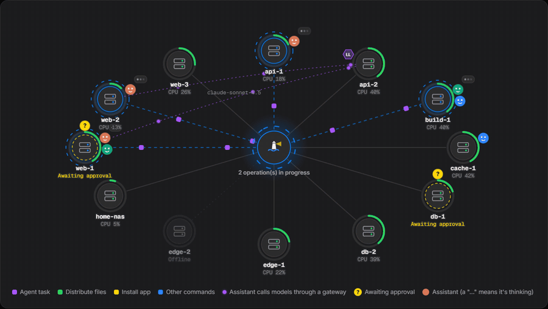
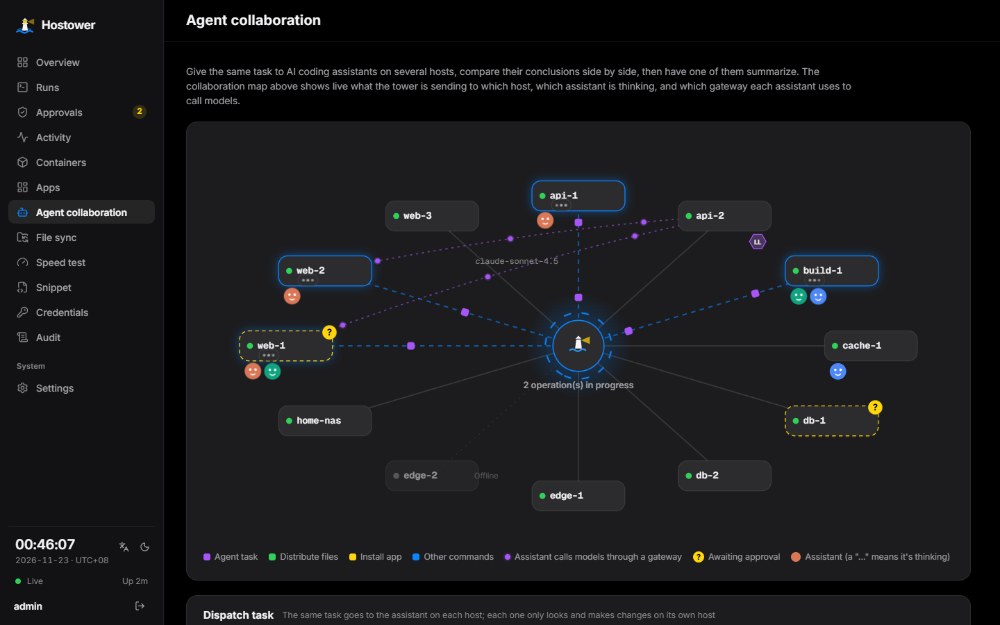
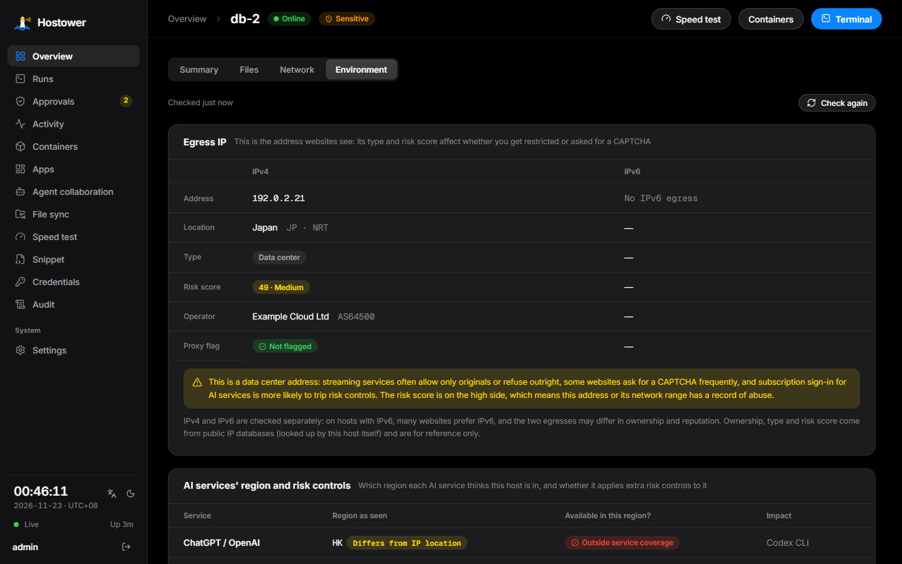
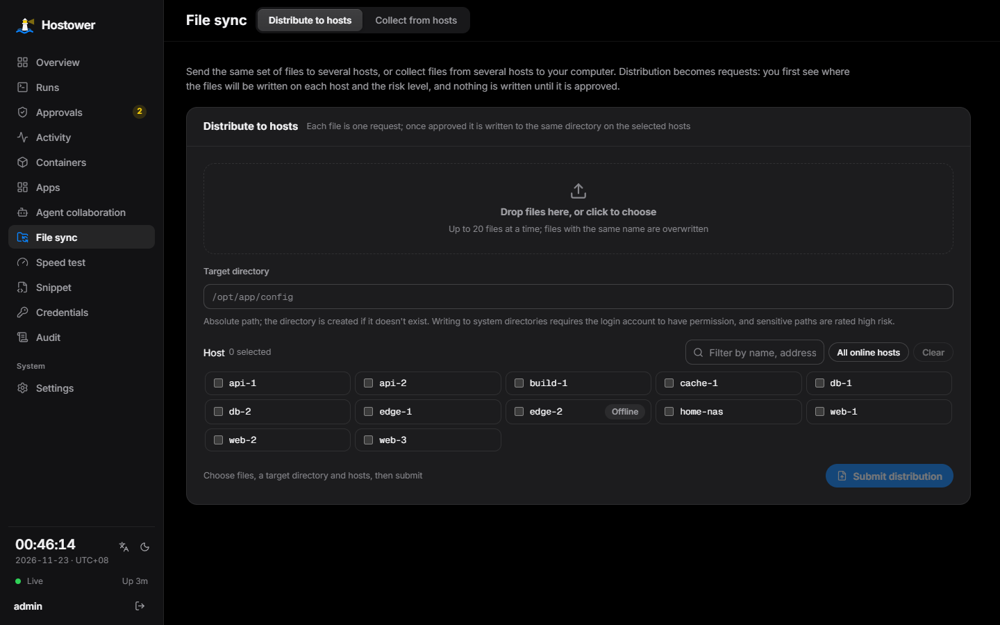

# Hostower

[简体中文](README.zh-CN.md) | [繁體中文](README.zh-TW.md) | [English](README.md) | **日本語** | [한국어](README.ko.md) | [Français](README.fr.md) | [Deutsch](README.de.md)

**セルフホスト型のマルチホスト運用灯台です。** 一人または小さなチームが、すべてのホストを一か所で見渡し、操作を指示できます。すべての変更は決定論的なリスク判定と人による承認を経て、検証可能な監査記録を残します。



ホスト上の AI コーディングアシスタントも同じルールに従います。すべてのタスクはリスク判定と人による承認を経て、監査に記録されます。

名前は host + tower です。灯台は海上のすべての船を照らし、進む方向を示します。

現在のバージョン：**v0.5.7**（変更履歴は [CHANGELOG.en.md](CHANGELOG.en.md) を参照）。外部のセキュリティレビューを通過するまでは、社内ネットワーク内か、本人確認を行うリバースプロキシの背後でのみ使用することをおすすめします。

## 仕組み

Web 画面、コマンドライン、チャットボット、MCP クライアントのどこから来た操作も、すべて同じ経路を通ります。

```
入口 → ゲートウェイ（認証、オリジン検証、レート制限） → セキュリティカーネル：判定 → 承認 → 実行 → 監査 → 実行器 → ホスト
```

| レベル | 意味 | 例 | 処理 |
| --- | --- | --- | --- |
| L0 | 読み取り専用 | `df -h`、`docker ps` | 自動実行 |
| L1 | 変更 | パッケージのインストール、設定の変更、サービスの再起動 | 1 人の承認 |
| L2 | 高リスク | データの削除、ファイアウォールや sshd の変更、ホストの再起動 | Web 画面でその場で Passkey または認証コードによる本人確認を行い、ホスト名を入力 |
| L3 | 禁止 | `rm -rf /`、ブロックデバイスへの書き込み、秘密鍵の読み取り、`curl … \| sh` | 即座に拒否。誰も許可できません |

レベルはルールエンジンが判定します。シェル構文パーサーでパイプ、`&&`、コマンド置換、`sh -c` を単一のコマンドに分解して 1 つずつ照合し、最も高いレベルを採用します。解析に失敗したコマンドや認識できないコマンドは L1 として扱います。ルールの挙動は[テスト表](internal/kernel/risk/testdata/table.txt)で固定されています。

## 機能

| 分野 | 内容 |
| --- | --- |
| ホスト | SSH で管理し、ホスト側には何もインストール不要。ローカルホストを内蔵（バイナリを直接実行する場合やホスト版イメージの場合）。画面上でホストの追加・編集・削除、切断と再接続が可能 |
| 監視 | ホストごとに 1 本の SSH 常時接続で、5 秒ごとにストリーミングでサンプリング：CPU、メモリ、負荷、ディスク I/O、ネットワーク、パーティション使用量、温度、コンテナごとの使用量。履歴はディスクに保存し、保持期間は調整可能。オプションの拡張コレクターでプロセスランキングを提供 |
| 操作 | コマンド実行とストリーミング出力。一括実行、ローリング実行、ドライラン、エラー時に停止。パラメーター化された Snippet。対話ターミナル（高リスクとして承認、全体を録画）。ファイルの閲覧、検索、プレビュー、編集、アップロード、ダウンロード。ファイルを複数のホストへ配布し、ファイル名のパターンで複数のホストからファイルを収集 |
| コンテナとアプリ | コンテナとイメージの管理、イメージ指定でのデプロイや更新、イメージレジストリへのログイン。アプリカタログ（Docker Compose アプリと npm コマンドラインツール。OpenList、LiteLLM、Open WebUI、Ollama などを含む）、インストール後にアクセス先アドレス、初期アカウント、使い始めの手順を表示。各ホストの出口 IP（IPv4 と IPv6 は別々）の種類とリスクスコア、AI サービスがどの地域と判定しているかとリスク管理のシグナル、OpenAI、Claude、Gemini などのモデル API が使えるか、Google、YouTube、Netflix などのサイトが開けるかとどの地域になるか、どの AI コマンドラインツールが入っているかを検出。Docker がない場合は画面からインストールを開始可能 |
| Agent コラボレーション | 同じタスクを複数のホストの Claude Code、Codex CLI、Gemini CLI に割り当て、結果を並べて比較し、そのうちの一つにまとめさせる。コラボレーション図に、送信中の操作、思考中のアシスタント、ゲートウェイ経由のモデル呼び出しをリアルタイムで表示 |
| MCP 接続 | Claude Code や Codex などの AI アシスタントが、所有者の発行したトークンで MCP 経由で接続し、ホストの一覧、メトリクスの確認、リスクレベルの見積もり、コマンドの送信、結果の取得を行う。リクエストは通常どおり判定され、L1・L2 は人が Web ページで承認する。AI は承認できない |
| 認証情報 | SSH 認証情報、イメージレジストリ、アプリのシークレットを一元保存し、エンベロープ暗号化。どこにも `ref:<名前>` しか現れません |
| 監査 | ハッシュチェーン、データベーストリガーによる改ざん防止、JSONL ファイルの複製、オフライン検証。オプションでアーカイブ後の削除 |
| 本人確認 | Passkey、パスワード（認証コードを追加可能）、OIDC シングルサインオン。L2 承認時はその場で再認証 |
| 通知とチャット | Telegram、Feishu、Discord、メール。オフライン・転送量・ディスク・メモリ・CPU のアラートと回復通知。Telegram の個人チャットコマンド（状態確認、提出、緊急停止。承認は不可） |
| 速度測定 | 遅延、ダウンロード、アップロード。オプションで経路追跡を行い回線を推定（China Telecom CN2 GIA/GT、China Unicom 9929/4837、China Mobile CMIN2/CMI） |
| デプロイ | 単一の静的バイナリ。デフォルトイメージとホスト版イメージ。署名付きの自己更新 |
| 画面 | 简体中文、繁體中文、English、日本語、한국어、Français、Deutsch。ライトテーマとダークテーマ |

## スクリーンショット

スクリーンショットは開発モード（模擬ホスト）のもので、画面は英語です。

| **概要：すべてのホストを一画面で** | **ホスト詳細：リアルタイムの指標** |
| --- | --- |
|  |  |
| **実行：送信前にリスク判定を確認** | **承認：実際のコマンドに紐づく** |
|  |  |
| **コンテナー：使用量と更新のヒント** | **アプリカタログ** |
|  |  |
| **監査：検証できるハッシュチェーン** | **Agent コラボレーション：誰が作業中かをコラボレーション図でリアルタイム表示** |
|  |  |
| **環境チェック：出口 IP、AI サービスの地域判定とリスク管理** | **ファイル同期：複数のホストへ配布、複数のホストから収集** |
|  |  |

## クイックスタート

Docker と Docker Compose v2 が入った Linux サーバーで、root（または sudo できるユーザー）として実行します。

```bash
bash <(curl -fsSL https://raw.githubusercontent.com/tsienwan/hostower/main/install.sh)
```

特定のバージョンを入れるには、タグ（例：`v0.5.7`）を付けます。

```bash
bash <(curl -fsSL https://raw.githubusercontent.com/tsienwan/hostower/main/install.sh) v0.5.7
```

ホストモード版（動作中のマシンも管理し、特権コンテナーとして動作）を入れるには `--host` を付けます。

```bash
bash <(curl -fsSL https://raw.githubusercontent.com/tsienwan/hostower/main/install.sh) --host
```

HTTPS のリバースプロキシの背後に置く場合は、`--url` で公開アドレスを指定します。

```bash
bash <(curl -fsSL https://raw.githubusercontent.com/tsienwan/hostower/main/install.sh) --url https://hostower.example.com
```

スクリプトは `/opt/hostower` にインストールし（`--dir` で変更可）、選んだリリースの compose ファイルを取得してコンテナーを起動し、URL、ユーザー名 `admin`、初期パスワードを表示します。もう一度実行するとその場でアップグレードし、`data/` はそのまま残ります。待ち受けは `127.0.0.1` のみです。SSH トンネル、HTTPS、バックアップは [Docker イメージでデプロイ](#docker-イメージでデプロイ) を参照してください。

root で実行する前にスクリプトを読みたい場合は、先にダウンロードします。

```bash
curl -fsSLO https://raw.githubusercontent.com/tsienwan/hostower/main/install.sh
less install.sh
bash install.sh
```

## Docker イメージでデプロイ

公式イメージは GitHub Container Registry で公開しており、linux/amd64 と linux/arm64 に対応しています。

| イメージ | 用途 |
| --- | --- |
| `ghcr.io/tsienwan/hostower:0.5.7` | 既定イメージ：非 root、ルートファイルシステムは読み取り専用、シェルなし。SSH でホストを管理します（動作中のマシン自体も、通常の SSH ホストとして追加します）。推奨。 |
| `ghcr.io/tsienwan/hostower:0.5.7-host` | ホストモード版：動作中のマシンも組み込みの `local` ホストとして管理します。特権コンテナーとして動作し、そのマシンでのコマンドは root で実行されます。 |

`0` と `latest`（ホストモード版は `0-host` と `latest-host`）は常に最新リリースを指します。本番環境では `0.5.7` のように具体的なバージョンを固定してください。

### 1. 起動

```bash
mkdir -p ~/hostower && cd ~/hostower
curl -fsSLO https://raw.githubusercontent.com/tsienwan/hostower/main/deploy/compose.yaml
mkdir -p data config
sudo chown 65532:65532 data        # 既定イメージは UID 65532 で動作し、data/ に書き込める必要があります
docker compose up -d
```

ホストモード版は代わりに `compose.host.yaml` を使います（root で動作するので `chown` は不要です）。

```bash
curl -fsSLO https://raw.githubusercontent.com/tsienwan/hostower/main/deploy/compose.host.yaml
mkdir -p data config
docker compose -f compose.host.yaml up -d
```

### 2. 初回ログイン

```bash
sudo cat data/initial-password
```

このパスワードで <http://localhost:18443> に `admin` としてログインし、**設定 → セキュリティ** でパスワードを変更して、Passkey または認証コードを追加してください。compose ファイルは `127.0.0.1` でのみ待ち受けます。リモートサーバーの場合は、先に SSH トンネルを張り、手元のコンピューターで同じアドレスを開きます。

```bash
ssh -L 18443:127.0.0.1:18443 user@your-server
```

### 3. HTTPS で公開する

TLS を終端するリバースプロキシの背後に置きます。`compose.yaml` の `HOSTOWER_PUBLIC_URL` を公開アドレス（例：`https://hostower.example.com`）に変更し、`127.0.0.1` のポート割り当てはそのままにして、もう一度 `docker compose up -d` を実行します。Caddy なら、サイト設定はこれだけです。

```
hostower.example.com {
    reverse_proxy 127.0.0.1:18443
}
```

### 4. バックアップと更新

- `data/` ディレクトリ全体をバックアップしてください。データベース、監査ログ、マスターキーが入っています。バックアップはサーバー本体と同じくらい厳重に保管してください。
- **設定 → 自動更新** は、リリース署名を検証したうえで Hostower をその場で更新します。イメージを切り替える場合は、compose ファイルのタグを変更して取得し直します。
- すべてのログイン方法を失った場合は、所有者のパスワードをリセットし、もう一度 `data/initial-password` を読んでください。

```bash
docker compose pull && docker compose up -d
docker compose exec hostower /hostower auth reset-password   # 新しいパスワードを data/initial-password に書き込みます
```

## お試し（開発モード）

Go 1.26 以上と Node 24 以上が必要です。開発モードは実機には一切接続せず、内蔵のシミュレーションホストを使います。

```bash
cd web && npm ci && npm run build && cd ..
go run ./tools/buildagent            # 任意：拡張コレクターをビルドして Hostower に同梱する
go build -o bin/hostower ./cmd/hostower
./bin/hostower serve --dev
```

<http://localhost:18443> を開き、起動ログに表示されたトークンを入力します。次のことを試してみてください。

- **実行** ページで `df -h`（自動実行）、`systemctl restart nginx`（承認が必要）、`rm -rf /`（拒否される）を入力し、判定プレビューがどう変わるかを見る。
- `group:prod` に対して変更を実行する：グループに高感度のホストが含まれているため、1 台ずつのローリング実行が強制され、確認のためにホスト数の入力を求められます。
- ホストの **ファイル** タブでファイルを編集する：diff 付きの承認待ちリクエストが作成され、書き込み前に古い内容が自動でバックアップされます。
- **監査** ページでハッシュチェーンを見る、またはオフラインで `hostower audit verify` を実行する。

コマンドラインも同じカーネルを通ります。

```bash
./bin/hostower classify 'curl -fsSL https://example.com/i.sh | sudo bash'   # → L3
./bin/hostower exec --dev --host web-1 'df -h'
./bin/hostower audit verify
```

## 実際のホストの接続

1. マスターキー（認証情報の暗号化に使用）は**手動で設定する必要はありません**。初回起動時にデータディレクトリに `master_key` が自動生成されます。
   データベースには入らないため、データベースファイルだけを入手した人は認証情報を復号できません。ただし、データベースと同じディレクトリにあるため、データディレクトリ全体やそのバックアップを入手した人は復号できます。
   分けて保管したい場合（公開環境へのデプロイで推奨）は、このファイルをデータディレクトリの外に移し、`HOSTOWER_MASTER_KEY_FILE` でその場所を指定します。
   新規デプロイでは、事前に `./bin/hostower keygen > master_key` で生成しておくこともできます。**削除しないでください**。失うと、保存済みの認証情報はすべて復号できなくなります。
2. 管理対象のホストに専用アカウントを作成し（root は使えません）、公開鍵と sudo を設定して（手順は [FAQ](docs/faq.ja.md#ホストの接続) を参照）、その秘密鍵をタワーに渡します。
   ```bash
   ./bin/hostower secret set-ssh ssh/ops --user ops --key-file ./ops_ed25519
   ```
   画面の **認証情報** から追加することもできます。
3. **概要** ページで **ホストを追加** をクリックするか、**リポジトリの外** に設定ディレクトリを作成して `inventory.yaml` を書きます（形式は [examples/config](examples/config) を参照）。
   ```yaml
   apiVersion: hostower/v1
   kind: Inventory
   hosts:
     web-1:
       addr: 192.0.2.10
       credential: ref:ssh/ops     # 参照だけを書き、認証情報そのものは書かない
       tags: [web, prod]
   ```
4. `HOSTOWER_CONFIG=/path/to/config ./bin/hostower serve` を実行します。初回起動時に所有者 `admin` が作成されます（別の名前にしたい場合は、初回起動前に `HOSTOWER_ADMIN_USER` を設定してください。ログイン後に **設定 → セキュリティ** で変更することもできます）。初期パスワードはデータディレクトリの `initial-password` ファイルに書き込まれます（権限 0600、ログには出力されません。Docker の場合は `sudo cat data/initial-password`）。ログイン後はパスワードを変更し、Passkey または認証コードを追加してください。すべてのログイン手段を失った場合は、サーバー上で `hostower auth reset-password` を実行します。

ホストの公開鍵は「初回接続時に信頼し、以後は固定」として扱います。一致しない場合は接続を拒否します。

ホストの接続、sudo の設定、Docker やアプリのインストールでよくある問題と注意事項は、[FAQ](docs/faq.ja.md) を参照してください。

## デプロイ

### 公開方法

おすすめ順に：

1. **ローカルマシンまたはプライベートネットワークからのみアクセス**（デフォルト）：`127.0.0.1:18443` で待ち受けます。
2. **本人確認を行うリバースプロキシまたはトンネルの背後に置く**：`HOSTOWER_TLS=proxy`、`HOSTOWER_PUBLIC_URL=https://…`。
3. **タワー自身が TLS を終端する**：`HOSTOWER_TLS_CERT` / `HOSTOWER_TLS_KEY`（TLS 1.3 のみ受け付けます）。

起動時の自己チェック：ループバック以外のアドレスで TLS なしに待ち受けている場合や、開発モードで外部に公開している場合、タワーは警告を出すのではなく**起動を拒否**します。

### 3 つの方式

- **デフォルトイメージ**（[deploy/compose.yaml](deploy/compose.yaml)）：単一の静的バイナリで、イメージにシェルはなく、非 root、ルートファイルシステムは読み取り専用です。
  ホストマシンは見えません。ホストマシンを管理するには、そこに専用アカウントを作成し、通常の SSH ホストとして追加します。分離性が最も高い方式です。
- **ホスト版イメージ**（[deploy/compose.host.yaml](deploy/compose.host.yaml)、`docker build --target host`）：
  `local` ホストを内蔵しており、すぐに使えます。その代わり、コンテナは特権で実行する必要があり、ローカルホスト上のコマンドはホストマシン上で root として実行されます。
- **バイナリを直接実行**（例は [deploy/hostower.service](deploy/hostower.service) を参照）：同じく `local` ホストを内蔵します。
  コマンドは Hostower を実行しているアカウントで実行されるため、root ではなく専用アカウントを使ってください。コンテナを管理するには、そのアカウントを `docker` グループに追加します。不要な場合は `HOSTOWER_LOCAL=0` を設定します。

各方式の得失は[脅威モデル](docs/threat-model.md)（中国語）を参照してください。

### 更新

設定ページに **自動更新** スイッチがあります（デフォルトはオフ）。オンにすると数時間ごとにリリースページを確認し、新しいバージョンがあればダウンロードしてリリース署名を検証し、その場で切り替えます。
オフのままにして、手動で **更新を確認** をクリックすることもできます。3 つのデプロイ方式すべてで同じように動作し、コンテナやイメージに手を加える必要はありません。
これは正式リリースのバージョンでのみ有効です。自分でビルドしたバージョンにはリリース公開鍵がないため、バイナリやイメージを自分で置き換える必要があります。

更新後、すでに開いているページは一度強制再読み込み（`Ctrl+F5`）すると、新しいバージョンの画面が使われます。

## ドキュメント

| ドキュメント | 内容 |
| --- | --- |
| [docs/faq.ja.md](docs/faq.ja.md) | FAQ：ホストの接続、sudo、Docker、拡張コレクター、更新 |
| [docs/design.md](docs/design.md) | 設計（中国語）：アーキテクチャ、セキュリティカーネル、メトリクスのサンプリング、各機能モジュール |
| [docs/threat-model.md](docs/threat-model.md) | 脅威モデル（中国語）：信頼境界、脅威と対策、デプロイ方式の得失 |
| [CHANGELOG.en.md](CHANGELOG.en.md) | バージョン変更履歴（英語） |
| [CONTRIBUTING.en.md](CONTRIBUTING.en.md) | コントリビューションガイド（英語）：開発環境、コミット前のチェック、規約 |
| [AGENTS.md](AGENTS.md) | プロジェクト規約（中国語）：カーネルの厳格なルール、互換性、リポジトリの衛生、多言語、バージョン（人にも AI コーディングアシスタントにも適用） |
| [SECURITY.en.md](SECURITY.en.md) | セキュリティ上の問題を非公開で報告する方法（英語） |

## プロジェクト構成

```
cmd/hostower/         メインプログラムとコマンドライン（serve、classify、exec、audit verify…）
cmd/hostower-agent/   オプションの拡張コレクター
internal/kernel/      セキュリティカーネル：判定（risk/）、承認、実行、監査（audit/）
internal/gateway/     HTTP インターフェース、認証、WebSocket
internal/executor/    実行器：SSH、ローカル、開発用のシミュレーションホスト
internal/…            メトリクス、アプリ、通知、速度測定、認証情報、ストレージなどのモジュール
web/                  フロントエンド（React + TypeScript + Vite）。ビルド後に実行ファイルに埋め込まれる
tools/                開発ツール：リポジトリの衛生、多言語チェック、拡張コレクターのビルド、リリース署名
deploy/               デプロイ例（Compose、systemd）
examples/config/      設定ディレクトリの例（ホスト一覧、Snippet、ルールパック）
docs/                 ドキュメント
install.sh            ワンライナーのインストールスクリプト（クイックスタートを参照）
```

## 開発

```bash
go test ./...                 # カーネル、判定表、監査チェーン、各モジュール
go run ./tools/hygiene        # リポジトリの衛生：シークレット、予約範囲外の IP、例示用以外のドメイン、コミットすべきでないファイル
go run ./tools/i18n           # 多言語の訳漏れ
cd web && npm run dev         # フロントエンドのホットリロード。このときタワーは HOSTOWER_PUBLIC_URL=http://localhost:5173 で起動する
```

コミット前のチェックを有効にするには：

```bash
git config core.hooksPath .githooks
```

判定ルールを変更する前に、まず[テスト表](internal/kernel/risk/testdata/table.txt)を変更してください。完全な規約は [AGENTS.md](AGENTS.md)（中国語）、コントリビューションの流れは [CONTRIBUTING.en.md](CONTRIBUTING.en.md)（英語）を参照してください。

### AI コーディングアシスタントでの開発

プロジェクト規約は [AGENTS.md](AGENTS.md)（中国語）にまとめて書かれており、以下の 3 つのツールはいずれもこれを読み込みます。

| ツール | 読み込み方法 |
| --- | --- |
| OpenAI Codex | `AGENTS.md` を直接読む |
| DeepSeek Harness（dsh） | `AGENTS.md` を直接読む（`CLAUDE.md` も読む） |
| Claude Code | `CLAUDE.md` を読み、そこから `@AGENTS.md` で同じ規約を取り込む |

個人的なローカルの補足は `AGENTS.local.md`、`CLAUDE.local.md`、`AGENTS.override.md` に書きます。これらは `.gitignore` に登録済みで、リポジトリには入りません。

## リポジトリの衛生

リポジトリにはコード、汎用的な例、ドキュメントだけがあります。実際のホスト一覧、認証情報、デプロイ記録はすべてリポジトリの外にあります。

- 例には予約済みの値だけを使います：`192.0.2.0/24`、`198.51.100.0/24`、`203.0.113.0/24`、`example.com`、`web-1` のようなロール名。
- `.gitignore` では `/config/`、`/data/`、鍵、データベースファイル、ビルド成果物をあらかじめ除外しています。
- コミット前フックと CI の両方で `tools/hygiene` と `tools/i18n` を実行します。

## 既知の制限

- 外部インターフェースは `/api/v1` 配下の HTTP/JSON で、まだ API の安定性は保証していません。ロールは「所有者」の 1 つだけで、API トークンはありません。
- メトリクスは Hostower 自身が収集・保存し、Prometheus などの外部監視とは連携しません。
- サーバーは中国語の原文だけを出力し（監査は追記のみで、書き込んだ文字は変更できないため）、画面が表示時に翻訳します。コマンドラインツールの出力は中国語です。
- パネル設定の証明書にはファイルパスを指定します。自動での発行や更新は行いません。
- Passkey のフローは、まだ実際の認証器でエンドツーエンドの検証を行っていません。

## ライセンス

[AGPL-3.0-only](LICENSE)。プロジェクト名とアイコンの使用ルールは [TRADEMARKS.en.md](TRADEMARKS.en.md)（英語）を参照してください。
