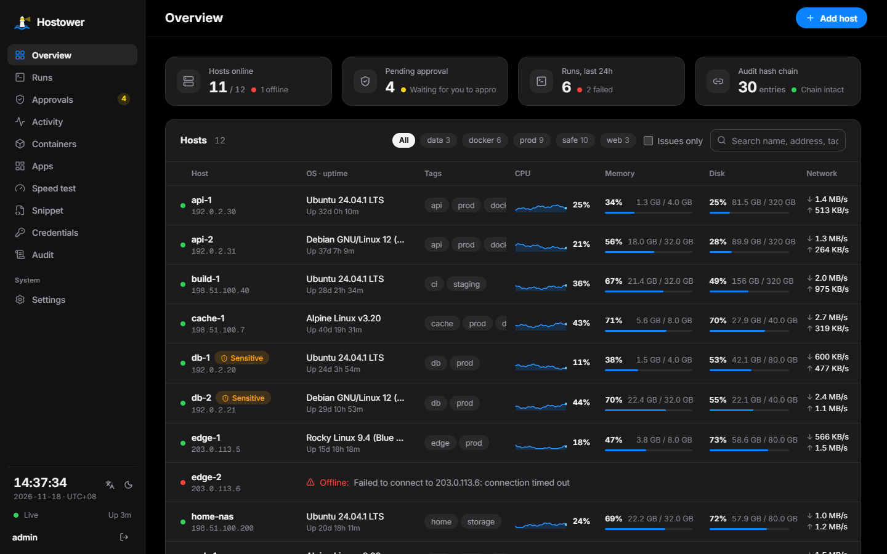
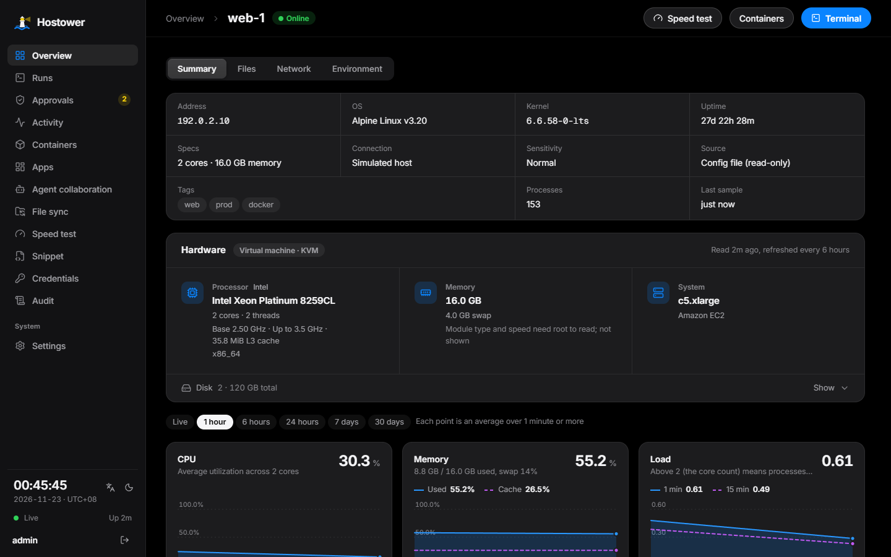

# Hostower

[简体中文](README.zh-CN.md) | [繁體中文](README.zh-TW.md) | [English](README.md) | [日本語](README.ja.md) | **한국어** | [Français](README.fr.md) | [Deutsch](README.de.md)

**자체 호스팅하는 다중 호스트 운영 등대입니다.** 한 사람이나 작은 팀이 모든 호스트를 한곳에서 살펴보고 작업을 지시할 수 있습니다. 모든 변경은 결정적인 위험 판정과 사람의 승인을 거치며, 검증 가능한 감사 기록을 남깁니다.

이름은 host + tower입니다. 등대는 바다 위의 모든 배를 비추고 그 배들에 방향을 알려 줍니다.

현재 버전: **v0.1.0**(변경 기록은 [CHANGELOG.en.md](CHANGELOG.en.md) 참고). 외부 보안 검토를 통과하기 전까지는 내부망에서만 사용하거나, 사용자 인증을 수행하는 리버스 프록시 뒤에 두고 사용하는 것을 권장합니다.

## 작동 방식

모든 작업은 웹, 명령줄, 챗봇 중 어디에서 들어오든 같은 경로를 거칩니다.

```
진입점 → 게이트웨이(인증, 출처 확인, 속도 제한) → 보안 커널: 등급 판정 → 승인 → 실행 → 감사 → 실행기 → 호스트
```

| 등급 | 의미 | 예시 | 처리 |
| --- | --- | --- | --- |
| L0 | 읽기 전용 | `df -h`, `docker ps` | 자동 실행 |
| L1 | 변경 | 패키지 설치, 설정 변경, 서비스 재시작 | 한 사람의 승인 |
| L2 | 고위험 | 데이터 삭제, 방화벽이나 sshd 변경, 호스트 재부팅 | 웹에서 그 자리에서 Passkey나 인증 코드로 본인 확인을 하고 호스트 이름을 입력 |
| L3 | 금지 | `rm -rf /`, 블록 장치 쓰기, 개인 키 읽기, `curl … \| sh` | 즉시 거부되며 누구도 허용할 수 없음 |

등급 판정은 규칙 엔진이 수행합니다. shell 구문 분석기로 파이프, `&&`, 명령 치환, `sh -c`를 단일 명령으로 나누어 하나씩 대조하고 가장 높은 등급을 취합니다. 구문 분석에 실패하거나 알 수 없는 명령은 L1로 처리합니다. 규칙의 동작은 [테스트 표](internal/kernel/risk/testdata/table.txt)로 고정되어 있습니다.

## 기능

| 영역 | 내용 |
| --- | --- |
| 호스트 | SSH로 관리하며 호스트에는 아무것도 설치하지 않음. 로컬 호스트 내장(바이너리를 직접 실행하거나 호스트 모드 이미지를 쓸 때). 화면에서 호스트 추가, 편집, 삭제, 연결 끊기와 다시 연결 |
| 모니터링 | 호스트마다 SSH 장기 연결 하나로 5초마다 스트리밍 샘플링: CPU, 메모리, 부하, 디스크 읽기/쓰기, 네트워크, 파티션 사용량, 온도, 컨테이너별 사용량. 기록은 디스크에 저장되며 보존 기간 조정 가능. 선택 사항인 고급 수집 프로그램이 프로세스 순위를 제공 |
| 작업 | 명령 실행과 스트리밍 출력. 일괄 실행, 순차(롤링) 실행, 사전 점검(드라이 런), 오류 시 중지. 매개변수화된 Snippet. 대화형 터미널(고위험으로 승인, 전 과정 녹화). 파일 탐색, 검색, 미리 보기, 편집, 업로드, 다운로드 |
| 컨테이너와 앱 | 컨테이너와 이미지 관리, 이미지로 배포하거나 업데이트, 이미지 레지스트리 로그인. 앱 카탈로그(Docker Compose 앱과 npm 명령줄 도구). Docker가 없으면 화면에서 설치를 시작할 수 있음 |
| 자격 증명 | SSH 자격 증명, 이미지 레지스트리, 앱 비밀 값을 한곳에 봉투 암호화로 저장. 어디에서든 `ref:<이름>`만 나타남 |
| 감사 | 해시 체인, 데이터베이스 트리거로 변조 방지, JSONL 파일 사본, 오프라인 검증. 선택 사항인 보관 후 정리 |
| 인증 | Passkey, 비밀번호(인증 코드 추가 가능), OIDC 단일 로그인(SSO). L2 승인 시 그 자리에서 다시 본인 확인 |
| 알림과 채팅 | Telegram, Feishu(Lark), Discord, 이메일. Telegram 개인 채팅 명령(상태 조회, 제출, 긴급 일시 중지. 승인은 불가) |
| 속도 측정 | 지연 시간, 다운로드, 업로드. 선택적으로 경로 추적을 하여 회선을 추정(China Telecom CN2 GIA/GT, China Unicom 9929/4837, China Mobile CMIN2/CMI) |
| 배포 | 단일 정적 바이너리. 기본 이미지와 호스트 모드 이미지. 서명된 자동 업데이트 |
| 인터페이스 | 简体中文, 繁體中文, English, 日本語, 한국어, Français, Deutsch. 밝은 테마와 어두운 테마 |

## 스크린샷

스크린샷은 개발 모드(모의 호스트)에서 찍었으며 화면은 영어입니다.

| **개요: 모든 호스트를 한눈에** | **호스트 상세: 실시간 지표** |
| --- | --- |
|  |  |
| **실행: 제출 전에 위험 등급 미리 보기** | **승인: 실제 명령에 묶임** |
|  |  |
| **컨테이너: 사용량과 업데이트 안내** | **앱 카탈로그** |
|  |  |
| **감사: 검증 가능한 해시 체인** |  |
|  |  |

## 빠른 시작

Docker와 Docker Compose v2가 설치된 Linux 서버에서 root(또는 sudo 가능한 계정)로 실행합니다.

```bash
bash <(curl -fsSL https://raw.githubusercontent.com/tsienwan/hostower/main/install.sh)
```

특정 버전을 설치하려면 태그(예: `v0.1.0`)를 붙입니다.

```bash
bash <(curl -fsSL https://raw.githubusercontent.com/tsienwan/hostower/main/install.sh) v0.1.0
```

호스트 모드 이미지(실행 중인 머신도 관리하며 특권 컨테이너로 실행)를 설치하려면 `--host`를 붙입니다.

```bash
bash <(curl -fsSL https://raw.githubusercontent.com/tsienwan/hostower/main/install.sh) --host
```

HTTPS 리버스 프록시 뒤에 둘 경우 `--url`로 공개 주소를 지정합니다.

```bash
bash <(curl -fsSL https://raw.githubusercontent.com/tsienwan/hostower/main/install.sh) --url https://hostower.example.com
```

스크립트는 `/opt/hostower`에 설치하고(`--dir`로 변경 가능), 선택한 릴리스의 compose 파일을 받아 컨테이너를 시작한 뒤 URL, 사용자 이름 `admin`, 초기 비밀번호를 출력합니다. 다시 실행하면 그 자리에서 업그레이드하며 `data/`는 그대로 유지됩니다. `127.0.0.1`에서만 수신합니다. SSH 터널, HTTPS, 백업은 [Docker 이미지로 배포](#docker-이미지로-배포)를 참고하세요.

root로 실행하기 전에 스크립트를 먼저 읽어 보고 싶다면 내려받아서 실행하세요.

```bash
curl -fsSLO https://raw.githubusercontent.com/tsienwan/hostower/main/install.sh
less install.sh
bash install.sh
```

## Docker 이미지로 배포

공식 이미지는 GitHub Container Registry에 게시되며 linux/amd64와 linux/arm64를 지원합니다.

| 이미지 | 용도 |
| --- | --- |
| `ghcr.io/tsienwan/hostower:0.1.0` | 기본 이미지: root가 아니고 루트 파일 시스템은 읽기 전용이며 셸이 없습니다. SSH로 호스트를 관리합니다(실행 중인 머신 자체도 일반 SSH 호스트로 추가). 권장합니다. |
| `ghcr.io/tsienwan/hostower:0.1.0-host` | 호스트 모드 이미지: 실행 중인 머신도 내장 `local` 호스트로 관리합니다. 특권 컨테이너로 실행되며 그 머신에서의 명령은 root로 실행됩니다. |

`0`과 `latest`(호스트 모드는 `0-host`와 `latest-host`)는 항상 최신 릴리스를 가리킵니다. 운영 환경에서는 `0.1.0`처럼 정확한 버전을 고정하세요.

### 1. 시작

```bash
mkdir -p ~/hostower && cd ~/hostower
curl -fsSLO https://raw.githubusercontent.com/tsienwan/hostower/main/deploy/compose.yaml
mkdir -p data config
sudo chown 65532:65532 data        # 기본 이미지는 UID 65532로 실행되므로 data/에 쓸 수 있어야 합니다
docker compose up -d
```

호스트 모드 이미지는 대신 `compose.host.yaml`을 사용합니다(root로 실행되므로 `chown`이 필요 없습니다).

```bash
curl -fsSLO https://raw.githubusercontent.com/tsienwan/hostower/main/deploy/compose.host.yaml
mkdir -p data config
docker compose -f compose.host.yaml up -d
```

### 2. 첫 로그인

```bash
sudo cat data/initial-password
```

이 비밀번호로 <http://localhost:18443>에 `admin`으로 로그인한 뒤 **설정 → 보안**에서 비밀번호를 바꾸고 Passkey 또는 인증 코드를 추가하세요. compose 파일은 `127.0.0.1`에서만 수신합니다. 원격 서버라면 먼저 SSH 터널을 열고 내 컴퓨터에서 같은 주소를 엽니다.

```bash
ssh -L 18443:127.0.0.1:18443 user@your-server
```

### 3. HTTPS로 외부에 제공

TLS를 종료하는 리버스 프록시 뒤에 둡니다. `compose.yaml`에서 `HOSTOWER_PUBLIC_URL`을 공개 주소(예: `https://hostower.example.com`)로 바꾸고 `127.0.0.1` 포트 매핑은 그대로 둔 채 `docker compose up -d`를 다시 실행합니다. Caddy를 쓰면 사이트 설정은 이것뿐입니다.

```
hostower.example.com {
    reverse_proxy 127.0.0.1:18443
}
```

### 4. 백업과 업데이트

- `data/` 디렉터리 전체를 백업하세요. 데이터베이스, 감사 로그, 마스터 키가 들어 있습니다. 백업은 서버 자체만큼 안전하게 보관하세요.
- **설정 → 자동 업데이트**는 릴리스 서명을 검증한 뒤 Hostower를 그 자리에서 업데이트합니다. 이미지를 바꾸려면 compose 파일의 태그를 수정하고 다시 받아 옵니다.
- 모든 로그인 방법을 잃었다면 소유자 비밀번호를 재설정한 뒤 `data/initial-password`를 다시 읽으세요.

```bash
docker compose pull && docker compose up -d
docker compose exec hostower /hostower auth reset-password   # 새 비밀번호를 data/initial-password에 기록합니다
```

## 빠른 체험(개발 모드)

Go 1.26+와 Node 24+가 필요합니다. 개발 모드는 실제 머신에 전혀 연결하지 않고 내장된 시뮬레이션 호스트를 사용합니다.

```bash
cd web && npm ci && npm run build && cd ..
go run ./tools/buildagent            # 선택 사항: 고급 수집 프로그램을 빌드해 Hostower에 포함시킴
go build -o bin/hostower ./cmd/hostower
./bin/hostower serve --dev
```

<http://localhost:18443>을 열고 시작 로그에 출력된 토큰을 입력합니다. 다음을 시도해 보세요.

- **실행** 페이지에서 `df -h`(자동 실행), `systemctl restart nginx`(승인 필요), `rm -rf /`(거부)를 입력하고 등급 판정 미리 보기가 어떻게 바뀌는지 확인합니다.
- `group:prod`에 변경 명령을 실행합니다. 그룹에 민감도가 높은 호스트가 있으므로 한 대씩 순차 실행이 강제되고, 호스트 수를 입력해 확인해야 합니다.
- 호스트의 **파일** 탭에서 파일을 하나 수정합니다. diff가 포함된 승인 대기 요청이 생성되고, 쓰기 전에 이전 내용이 자동으로 백업됩니다.
- **감사** 페이지에서 해시 체인을 보거나, 오프라인으로 `hostower audit verify`를 실행합니다.

명령줄도 같은 커널을 거칩니다.

```bash
./bin/hostower classify 'curl -fsSL https://example.com/i.sh | sudo bash'   # → L3
./bin/hostower exec --dev --host web-1 'df -h'
./bin/hostower audit verify
```

## 실제 호스트 연결

1. 마스터 키(자격 증명 암호화용)는 **직접 설정할 필요가 없습니다**. 처음 시작할 때 데이터 디렉터리에 `master_key`가 자동으로 생성됩니다.
   이 키는 데이터베이스에 들어가지 않으므로 데이터베이스 파일만 손에 넣은 사람은 자격 증명을 복호화할 수 없습니다. 하지만 데이터베이스와 같은 디렉터리에 있으므로, 데이터 디렉터리 전체나 그 백업을 손에 넣은 사람은 복호화할 수 있습니다.
   따로 보관하려면(공개 네트워크 배포에 권장) 이 파일을 데이터 디렉터리 밖으로 옮기고 `HOSTOWER_MASTER_KEY_FILE`로 그 위치를 지정합니다.
   새로 배포하는 경우 `./bin/hostower keygen > master_key`로 미리 생성해 둘 수도 있습니다. **절대 삭제하지 마세요.** 이 키를 잃으면 저장된 자격 증명을 모두 복호화할 수 없습니다.
2. 관리 대상 호스트에 전용 계정을 만들고(root는 사용할 수 없음) 공개 키와 sudo를 설정한 뒤(방법은 [자주 묻는 질문](docs/faq.ko.md#호스트-연결) 참고), 그 계정의 개인 키를 타워에 넘겨줍니다.
   ```bash
   ./bin/hostower secret set-ssh ssh/ops --user ops --key-file ./ops_ed25519
   ```
   화면의 **자격 증명**에서 추가할 수도 있습니다.
3. **개요** 페이지에서 **호스트 추가**를 클릭하거나, **저장소 밖에** 설정 디렉터리를 만들고 `inventory.yaml`을 작성합니다(형식은 [examples/config](examples/config) 참고).
   ```yaml
   apiVersion: hostower/v1
   kind: Inventory
   hosts:
     web-1:
       addr: 192.0.2.10
       credential: ref:ssh/ops     # 참조만 적고, 자격 증명 자체는 적지 않음
       tags: [web, prod]
   ```
4. `HOSTOWER_CONFIG=/path/to/config ./bin/hostower serve`를 실행합니다. 처음 시작할 때 소유자 `admin`이 생성됩니다(다른 이름을 쓰려면 처음 시작하기 전에 `HOSTOWER_ADMIN_USER`를 설정하거나, 로그인한 뒤 **설정 → 보안**에서 바꿀 수 있습니다). 초기 비밀번호는 데이터 디렉터리의 `initial-password` 파일에 기록됩니다(권한 0600, 로그에는 남지 않음. Docker를 쓰는 경우 `sudo cat data/initial-password`). 로그인한 뒤 비밀번호를 바꾸고 Passkey나 인증 코드를 추가하세요. 모든 로그인 수단을 잃었다면 서버에서 `hostower auth reset-password`를 실행합니다.

호스트 공개 키는 "처음 연결할 때 신뢰하고 이후에는 고정"하는 방식으로 처리하며, 일치하지 않으면 연결을 거부합니다.

호스트 연결, sudo 설정, Docker 설치, 앱 설치에서 자주 겪는 문제와 주의 사항은 [자주 묻는 질문](docs/faq.ko.md)을 참고하세요.

## 배포

### 노출 방식

권장 순서는 다음과 같습니다.

1. **로컬 머신이나 사설망에서만 접근**(기본값): `127.0.0.1:18443`에서 수신합니다.
2. **사용자 인증을 수행하는 리버스 프록시나 터널 뒤에 배치**: `HOSTOWER_TLS=proxy`, `HOSTOWER_PUBLIC_URL=https://…`.
3. **타워가 직접 TLS를 종료**: `HOSTOWER_TLS_CERT` / `HOSTOWER_TLS_KEY`(TLS 1.3만 허용).

시작 시 자체 점검: 루프백이 아닌 주소에서 TLS 없이 수신하거나, 개발 모드를 외부에 노출하면 타워는 경고를 출력하는 대신 **시작을 거부합니다**.

### 세 가지 방식

- **기본 이미지**([deploy/compose.yaml](deploy/compose.yaml)): 단일 정적 바이너리이며, 이미지에 shell이 없고, root가 아니며, 루트 파일 시스템은 읽기 전용입니다.
  호스트 머신을 볼 수 없습니다. 호스트 머신을 관리하려면 그 머신에 전용 계정을 만들고 일반 SSH 호스트로 추가합니다. 격리 수준이 가장 높습니다.
- **호스트 모드 이미지**([deploy/compose.host.yaml](deploy/compose.host.yaml), `docker build --target host`):
  `local` 호스트가 내장되어 있어 바로 쓸 수 있습니다. 대가로 컨테이너를 특권 모드로 실행해야 하며, 로컬 호스트의 명령은 호스트 머신에서 root로 실행됩니다.
- **바이너리 직접 실행**(예시는 [deploy/hostower.service](deploy/hostower.service) 참고): 마찬가지로 `local` 호스트가 내장되어 있습니다.
  명령은 Hostower를 실행하는 계정으로 실행되므로 root가 아닌 전용 계정을 사용하세요. 컨테이너를 관리하려면 그 계정을 `docker` 그룹에 추가합니다. 필요 없으면 `HOSTOWER_LOCAL=0`을 설정합니다.

각 방식의 장단점은 [위협 모델](docs/threat-model.md)(중국어)을 참고하세요.

### 업데이트

설정 페이지에 **자동 업데이트** 스위치가 있습니다(기본값은 꺼짐). 켜면 몇 시간마다 릴리스 페이지를 확인하고, 새 버전이 있으면 다운로드해 릴리스 서명을 검증한 뒤 그 자리에서 전환합니다.
꺼 둔 채로 **업데이트 확인**을 직접 클릭할 수도 있습니다. 세 가지 배포 방식 모두 같으며, 컨테이너와 이미지는 손댈 필요가 없습니다.
이 기능은 정식 릴리스 버전에서만 동작합니다. 직접 빌드한 버전에는 릴리스 공개 키가 없으므로 바이너리나 이미지를 직접 교체해야 합니다.

업데이트한 뒤에는 이미 열려 있는 페이지를 한 번 강제 새로 고침(`Ctrl+F5`)해야 새 버전의 화면이 적용됩니다.

## 문서

| 문서 | 내용 |
| --- | --- |
| [docs/faq.ko.md](docs/faq.ko.md) | 자주 묻는 질문: 호스트 연결, sudo, Docker, 고급 수집, 업데이트 |
| [docs/design.md](docs/design.md) | 설계(중국어): 아키텍처, 보안 커널, 지표 샘플링, 각 기능 모듈 |
| [docs/threat-model.md](docs/threat-model.md) | 위협 모델(중국어): 신뢰 경계, 위협과 대책, 배포 방식의 장단점 |
| [CHANGELOG.en.md](CHANGELOG.en.md) | 버전 변경 기록 |
| [CONTRIBUTING.en.md](CONTRIBUTING.en.md) | 기여 가이드: 개발 환경, 커밋 전 검사, 규약 |
| [AGENTS.md](AGENTS.md) | 프로젝트 규범(중국어): 커널 하드 규칙, 호환성, 저장소 위생, 다국어, 버전(사람과 AI 코딩 도우미 모두에게 적용) |
| [SECURITY.en.md](SECURITY.en.md) | 보안 문제를 비공개로 보고하는 방법 |

## 프로젝트 구조

```
cmd/hostower/         메인 프로그램과 명령줄(serve, classify, exec, audit verify…)
cmd/hostower-agent/   선택 사항인 고급 수집 프로그램
internal/kernel/      보안 커널: 등급 판정(risk/), 승인, 실행, 감사(audit/)
internal/gateway/     HTTP 인터페이스, 인증, WebSocket
internal/executor/    실행기: SSH, 로컬, 개발용 시뮬레이션 호스트
internal/…            지표, 앱, 알림, 속도 측정, 자격 증명, 저장소 등 모듈
web/                  프런트엔드(React + TypeScript + Vite), 빌드 후 실행 파일에 포함됨
tools/                개발 도구: 저장소 위생, 다국어 검사, 고급 수집 프로그램 빌드, 릴리스 서명
deploy/               배포 예시(Compose, systemd)
examples/config/      설정 디렉터리 예시(호스트 목록, Snippet, 규칙 팩)
docs/                 문서
install.sh            한 줄 설치 스크립트(빠른 시작 참고)
```

## 개발

```bash
go test ./...                 # 커널, 등급 판정 표, 감사 체인, 각 모듈
go run ./tools/hygiene        # 저장소 위생: 비밀 키, 예약 대역이 아닌 IP, 예시가 아닌 도메인, 커밋하면 안 되는 파일
go run ./tools/i18n           # 다국어 누락 여부
cd web && npm run dev         # 프런트엔드 핫 리로드. 이때 타워는 HOSTOWER_PUBLIC_URL=http://localhost:5173으로 시작
```

커밋 전 검사 활성화:

```bash
git config core.hooksPath .githooks
```

등급 판정 규칙을 바꾸기 전에 먼저 [테스트 표](internal/kernel/risk/testdata/table.txt)를 고치세요. 전체 규범은 [AGENTS.md](AGENTS.md)(중국어)를, 기여 절차는 [CONTRIBUTING.en.md](CONTRIBUTING.en.md)를 참고하세요.

### AI 코딩 도우미로 개발하기

프로젝트 규범은 [AGENTS.md](AGENTS.md)(중국어) 한곳에 모아 두었으며, 아래 세 가지 도구 모두 이 파일을 읽습니다.

| 도구 | 읽는 방식 |
| --- | --- |
| OpenAI Codex | `AGENTS.md`를 직접 읽음 |
| DeepSeek Harness(dsh) | `AGENTS.md`를 직접 읽음(`CLAUDE.md`도 함께 읽음) |
| Claude Code | `CLAUDE.md`를 읽으며, 이 파일이 `@AGENTS.md`로 같은 규범을 불러옴 |

개인적인 로컬 보충 내용은 `AGENTS.local.md`, `CLAUDE.local.md`, `AGENTS.override.md`에 적습니다. 이 파일들은 이미 `.gitignore`에 들어 있어 저장소에 들어가지 않습니다.

## 저장소 위생

저장소에는 코드, 일반적인 예시, 문서만 있습니다. 실제 호스트 목록, 자격 증명, 배포 기록은 모두 저장소 밖에 있습니다.

- 예시에는 예약된 값만 사용합니다: `192.0.2.0/24`, `198.51.100.0/24`, `203.0.113.0/24`, `example.com`, `web-1` 같은 역할 이름.
- `.gitignore`는 `/config/`, `/data/`, 키, 데이터베이스 파일, 빌드 산출물을 미리 무시합니다.
- 커밋 전 훅과 CI 모두 `tools/hygiene`와 `tools/i18n`을 실행합니다.

## 알려진 제한 사항

- 외부 인터페이스는 `/api/v1` 아래의 HTTP/JSON이며, 아직 안정적인 API를 약속하지 않습니다. 역할은 "소유자" 하나뿐이며 API 토큰은 없습니다.
- 지표는 Hostower가 직접 수집하고 저장하며, Prometheus 같은 외부 모니터링과 연동하지 않습니다.
- 서버는 중국어 원문만 출력하며(감사는 추가만 가능하므로 기록된 글자를 바꿀 수 없음), 화면에 표시할 때 인터페이스가 번역합니다. 명령줄 도구의 출력은 중국어입니다.
- 패널 설정의 인증서는 파일 경로를 입력하는 방식이며, 자동으로 발급하거나 갱신하지 않습니다.
- Passkey 흐름은 아직 실제 인증기로 처음부터 끝까지 검증되지 않았습니다.

## 라이선스

[AGPL-3.0-only](LICENSE). 프로젝트 이름과 아이콘의 사용 규칙은 [TRADEMARKS.en.md](TRADEMARKS.en.md)를 참고하세요.
