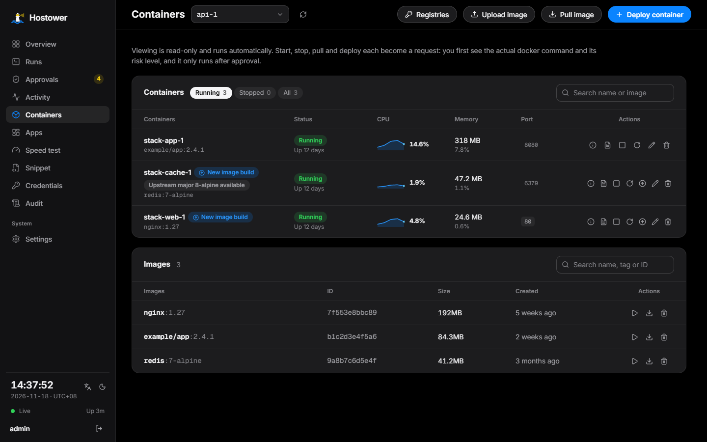

# Hostower

[简体中文](README.zh-CN.md) | [繁體中文](README.zh-TW.md) | **English** | [日本語](README.ja.md) | [한국어](README.ko.md) | [Français](README.fr.md) | [Deutsch](README.de.md)

**A self-hosted control tower for your servers.** One person or a small team can see every host in one place and act on them. Every change goes through a deterministic risk check and a human approval, and leaves a verifiable audit trail.

The name is host + tower: a lighthouse sees every ship on the water and guides them.

Current version: **v0.2.0** (see [CHANGELOG.en.md](CHANGELOG.en.md)). Until it has passed an external security review, run it on a private network or behind a reverse proxy that authenticates users.

## How it works

Every operation — from the web UI, the command line or the chat bot — takes the same path:

```
entry → gateway (authentication, origin check, rate limit) → security kernel: classify → approve → execute → audit → executor → host
```

| Level | Meaning | Examples | Handling |
| --- | --- | --- | --- |
| L0 | Read-only | `df -h`, `docker ps` | Runs automatically |
| L1 | Change | Install packages, edit config, restart services | One approval |
| L2 | High risk | Delete data, change the firewall or sshd, reboot | Approve in the web UI with an on-the-spot Passkey or authenticator code, and type the host name |
| L3 | Forbidden | `rm -rf /`, writing block devices, reading private keys, `curl … \| sh` | Refused outright; nobody can allow it |

A rule engine assigns the level: a shell parser splits pipes, `&&`, command substitution and `sh -c` into single commands, checks each one, and takes the highest level. Commands it cannot parse or does not recognize are L1. The engine's behavior is pinned by a [test table](internal/kernel/risk/testdata/table.txt).

## Features

| Area | What you get |
| --- | --- |
| Hosts | Managed over SSH with nothing to install on the host; a built-in local host (when running the binary directly or the host-mode image); add, edit, delete and reconnect hosts from the UI |
| Monitoring | One long-lived SSH connection per host streaming a sample every 5 seconds: CPU, memory, load, disk I/O, network, filesystem usage, temperature, per-container usage; history kept on disk with adjustable retention; an optional enhanced collector adds a process ranking |
| Operations | Run commands with streaming output; batches, rolling runs, dry runs, stop on error; parameterized Snippets; an interactive terminal (approved as L2, fully recorded); browse, search, preview, edit, upload and download files; distribute files to multiple hosts, and collect files from multiple hosts by file-name pattern |
| Containers and apps | Manage containers and images, deploy or update by image, log in to registries; an app catalog (Docker Compose apps and npm CLI tools, including OpenList, LiteLLM, Open WebUI and Ollama) that gives you the address, initial account and first steps once an app is installed; checks each host's egress IP type and risk score, whether it can use model APIs such as OpenAI, Claude and Gemini, whether sites such as Google, YouTube and Netflix open and in which region, and which AI CLI tools it has installed; install Docker from the UI on hosts that lack it |
| Credentials | SSH credentials, registry logins and app secrets stored centrally with envelope encryption; everywhere else only `ref:<name>` appears |
| Audit | Hash chain, database triggers against tampering, a JSONL file copy, offline verification; optional archive-then-prune |
| Sign-in | Passkeys, passwords (with optional authenticator codes), OIDC single sign-on; L2 approvals require re-verification on the spot |
| Notifications and chat | Telegram, Feishu/Lark, Discord, email; Telegram direct-message commands (status, submit, emergency pause — never approve) |
| Speed test | Latency, download and upload, with optional traceroutes that guess the carrier route (China Telecom CN2 GIA/GT, China Unicom 9929/4837, China Mobile CMIN2/CMI) |
| Deployment | A single static binary; a default image and a host-mode image; signed self-update |
| Interface | Simplified Chinese, Traditional Chinese, English, Japanese, Korean, French, German; light and dark themes |

## Screenshots

Screenshots are from development mode (simulated hosts).

| **Overview: every host at a glance** | **Host details: live metrics** |
| --- | --- |
|  |  |
| **Run: see the risk preview before submitting** | **Approval: bound to the exact command** |
|  |  |
| **Containers: usage and update hints** | **App catalog** |
|  |  |
| **Audit: a verifiable hash chain** |  |
|  |  |

## Quick start

On a Linux server with Docker and Docker Compose v2, run as root (or a user with sudo):

```bash
bash <(curl -fsSL https://raw.githubusercontent.com/tsienwan/hostower/main/install.sh)
```

To install a specific version, append its tag (for example `v0.2.0`):

```bash
bash <(curl -fsSL https://raw.githubusercontent.com/tsienwan/hostower/main/install.sh) v0.2.0
```

To install the host-mode image (it also manages the machine it runs on, and runs privileged), add `--host`:

```bash
bash <(curl -fsSL https://raw.githubusercontent.com/tsienwan/hostower/main/install.sh) --host
```

If it will sit behind an HTTPS reverse proxy, pass the public address with `--url`:

```bash
bash <(curl -fsSL https://raw.githubusercontent.com/tsienwan/hostower/main/install.sh) --url https://hostower.example.com
```

The script installs into `/opt/hostower` (change it with `--dir`), downloads the compose file of the chosen release, starts the container, and prints the URL, the user name `admin` and the initial password. Running it again upgrades in place and keeps `data/`. It only listens on `127.0.0.1`; see [Deploy with Docker](#deploy-with-docker) for the SSH tunnel, HTTPS and backups.

Prefer to read a script before running it as root? Download it first:

```bash
curl -fsSLO https://raw.githubusercontent.com/tsienwan/hostower/main/install.sh
less install.sh
bash install.sh
```

## Deploy with Docker

Official images are published to GitHub Container Registry for linux/amd64 and linux/arm64:

| Image | Use |
| --- | --- |
| `ghcr.io/tsienwan/hostower:0.2.0` | Default image: non-root, read-only, no shell. Manages hosts over SSH (including the machine it runs on, added as an ordinary SSH host). Recommended. |
| `ghcr.io/tsienwan/hostower:0.2.0-host` | Host-mode image: also manages the machine it runs on as the built-in `local` host. Runs privileged — commands on that machine run as root. |

`0` and `latest` (or `0-host` and `latest-host`) always point to the newest release; pin an exact version such as `0.2.0` in production.

### 1. Start

```bash
mkdir -p ~/hostower && cd ~/hostower
curl -fsSLO https://raw.githubusercontent.com/tsienwan/hostower/main/deploy/compose.yaml
mkdir -p data config
sudo chown 65532:65532 data        # the default image runs as UID 65532 and must be able to write data/
docker compose up -d
```

For the host-mode image, use `compose.host.yaml` instead (it runs as root, so no `chown` is needed):

```bash
curl -fsSLO https://raw.githubusercontent.com/tsienwan/hostower/main/deploy/compose.host.yaml
mkdir -p data config
docker compose -f compose.host.yaml up -d
```

### 2. First sign-in

```bash
sudo cat data/initial-password
```

Sign in as `admin` with that password at <http://localhost:18443>. Then change the password and add a Passkey or authenticator under **Settings → Security**. The compose files only listen on `127.0.0.1`; on a remote server, open an SSH tunnel first and browse to the same address on your computer:

```bash
ssh -L 18443:127.0.0.1:18443 user@your-server
```

### 3. Serve it over HTTPS

Put Hostower behind a reverse proxy that terminates TLS. In `compose.yaml`, set `HOSTOWER_PUBLIC_URL` to the public address (for example `https://hostower.example.com`) and keep the `127.0.0.1` port mapping, then run `docker compose up -d` again. With Caddy, the whole site configuration is:

```
hostower.example.com {
    reverse_proxy 127.0.0.1:18443
}
```

### 4. Back up and update

- Back up the whole `data/` directory: it holds the database, the audit log and the master key. Keep the backup as safe as the server itself.
- **Settings → Automatic updates** updates Hostower in place after verifying the release signature. To change the image instead, edit the tag in the compose file and pull.
- If every sign-in method is lost, reset the owner's password, then read `data/initial-password` again.

```bash
docker compose pull && docker compose up -d
docker compose exec hostower /hostower auth reset-password   # writes a new password to data/initial-password
```

## Try it (development mode)

You need Go 1.26+ and Node 24+. Development mode never touches a real machine; it uses built-in simulated hosts.

```bash
cd web && npm ci && npm run build && cd ..
go run ./tools/buildagent            # optional: build the enhanced collector so it ships inside Hostower
go build -o bin/hostower ./cmd/hostower
./bin/hostower serve --dev
```

Open <http://localhost:18443> and enter the token printed in the startup log. Things to try:

- On the **Run** page, type `df -h` (runs automatically), `systemctl restart nginx` (needs approval) and `rm -rf /` (refused), and watch the risk preview change.
- Run a change against `group:prod`: the group contains a high-sensitivity host, so the run is forced to go one host at a time and you must type the number of hosts to confirm.
- Edit a file on a host's **Files** tab: this creates a pending request with a diff, and the old content is backed up before writing.
- Look at the hash chain on the **Audit** page, or run `hostower audit verify` offline.

The command line goes through the same kernel:

```bash
./bin/hostower classify 'curl -fsSL https://example.com/i.sh | sudo bash'   # → L3
./bin/hostower exec --dev --host web-1 'df -h'
./bin/hostower audit verify
```

## Connecting real hosts

1. The master key (used to encrypt credentials) **needs no setup**: on first start, `master_key` is generated in the data directory.
   It is not stored in the database, so someone with only the database file cannot decrypt credentials — but it sits in the same directory, so anyone with the whole data directory or its backup can.
   To keep it separately (recommended for public deployments), move the file out of the data directory and point `HOSTOWER_MASTER_KEY_FILE` at it;
   for a fresh deployment you can also generate one first with `./bin/hostower keygen > master_key`. **Never delete it**: without it, saved credentials cannot be decrypted.
2. On the managed host, create a dedicated account (root is not allowed) and set up its public key and sudo (see the [FAQ](docs/faq.en.md#connecting-hosts)). Then give its private key to the tower:
   ```bash
   ./bin/hostower secret set-ssh ssh/ops --user ops --key-file ./ops_ed25519
   ```
   You can also add it under **Credentials** in the UI.
3. Click **Add host** on the Overview page, or create a config directory **outside the repository** with an `inventory.yaml` (format in [examples/config](examples/config)):
   ```yaml
   apiVersion: hostower/v1
   kind: Inventory
   hosts:
     web-1:
       addr: 192.0.2.10
       credential: ref:ssh/ops     # a reference only, never the credential itself
       tags: [web, prod]
   ```
4. Run `HOSTOWER_CONFIG=/path/to/config ./bin/hostower serve`. The first start creates the owner `admin` (set `HOSTOWER_ADMIN_USER` before the first start to use another name, or rename it later under **Settings → Security**). The initial password is written to `initial-password` in the data directory (mode 0600, never logged; with Docker: `sudo cat data/initial-password`). After signing in, change the password and add a Passkey or authenticator. If every sign-in method is lost, run `hostower auth reset-password` on the server.

Host keys are trusted on first connection and pinned afterwards; a mismatch is refused.

For common problems and tips on connecting hosts, sudo, Docker and apps, see the [FAQ](docs/faq.en.md).

## Deployment

### Exposure

In order of preference:

1. **Local machine or private network only** (default): listens on `127.0.0.1:18443`.
2. **Behind a reverse proxy or tunnel that authenticates users**: `HOSTOWER_TLS=proxy`, `HOSTOWER_PUBLIC_URL=https://…`.
3. **The tower terminates TLS itself**: `HOSTOWER_TLS_CERT` / `HOSTOWER_TLS_KEY` (TLS 1.3 only).

Startup self-check: listening on a non-loopback address without TLS, or exposing development mode, makes the tower **refuse to start** rather than print a warning.

### Three ways to run it

- **Default image** ([deploy/compose.yaml](deploy/compose.yaml)): a single static binary, no shell in the image, non-root, read-only root filesystem.
  It cannot see the host machine; to manage that machine, create a dedicated account on it and add it as an ordinary SSH host. Best isolation.
- **Host-mode image** ([deploy/compose.host.yaml](deploy/compose.host.yaml), `docker build --target host`):
  includes a `local` host out of the box. The trade-off: the container must run privileged, and commands on the local host run as root on the host machine.
- **Run the binary directly** (example in [deploy/hostower.service](deploy/hostower.service)): also includes the `local` host;
  commands run as the account that runs Hostower, so use a dedicated account rather than root, and add it to the `docker` group to manage containers. Set `HOSTOWER_LOCAL=0` if you don't need it.

The trade-offs are explained in the [threat model](docs/threat-model.md) (Chinese).

### Updates

**Settings** has an **Automatic updates** switch (off by default). When on, Hostower checks the releases page every few hours, downloads a new version, verifies its release signature and switches over in place.
You can leave it off and click **Check for updates** instead. All three deployment methods work the same way; containers and images stay as they are.
This only works for official releases; a self-built binary has no release key, so replace the binary or image yourself.

After an update, hard-refresh pages that are already open (`Ctrl+F5`) to load the new interface.

## Documentation

| Document | Contents |
| --- | --- |
| [docs/faq.en.md](docs/faq.en.md) | FAQ: connecting hosts, sudo, Docker, the enhanced collector, updates |
| [docs/design.md](docs/design.md) | Design (Chinese): architecture, security kernel, metric sampling, feature modules |
| [docs/threat-model.md](docs/threat-model.md) | Threat model (Chinese): trust boundaries, threats and mitigations, deployment trade-offs |
| [CHANGELOG.en.md](CHANGELOG.en.md) | Release history |
| [CONTRIBUTING.en.md](CONTRIBUTING.en.md) | Contributing: development setup, pre-commit checks, conventions |
| [AGENTS.md](AGENTS.md) | Project rules (Chinese): kernel invariants, compatibility, repository hygiene, i18n, versioning — for people and AI coding assistants alike |
| [SECURITY.en.md](SECURITY.en.md) | How to report security issues privately |

## Project layout

```
cmd/hostower/         main program and CLI (serve, classify, exec, audit verify…)
cmd/hostower-agent/   the optional enhanced collector
internal/kernel/      security kernel: classification (risk/), approval, execution, audit (audit/)
internal/gateway/     HTTP API, authentication, WebSocket
internal/executor/    executors: SSH, local, simulated hosts for development
internal/…            metrics, apps, notifications, speed test, credentials, storage and more
web/                  front end (React + TypeScript + Vite), embedded into the binary
tools/                developer tools: repository hygiene, i18n check, collector build, release signing
deploy/               deployment examples (Compose, systemd)
examples/config/      sample config directory (inventory, Snippets, rule packs)
docs/                 documentation
install.sh            one-line installer (see Quick start)
```

## Development

```bash
go test ./...                 # kernel, classification table, audit chain, modules
go run ./tools/hygiene        # repository hygiene: secrets, non-reserved IPs, non-example domains, files that must not be committed
go run ./tools/i18n           # missing translations
cd web && npm run dev         # front end with hot reload; start the tower with HOSTOWER_PUBLIC_URL=http://localhost:5173
```

Enable the pre-commit checks:

```bash
git config core.hooksPath .githooks
```

Change the [test table](internal/kernel/risk/testdata/table.txt) before changing a classification rule. The full rules are in [AGENTS.md](AGENTS.md); the contribution workflow is in [CONTRIBUTING.en.md](CONTRIBUTING.en.md).

### Working with AI coding assistants

The project rules live in one place, [AGENTS.md](AGENTS.md), and all three tools below read it:

| Tool | How it reads the rules |
| --- | --- |
| OpenAI Codex | Reads `AGENTS.md` directly |
| DeepSeek Harness (dsh) | Reads `AGENTS.md` directly (it also reads `CLAUDE.md`) |
| Claude Code | Reads `CLAUDE.md`, which pulls in the same rules with `@AGENTS.md` |

Put personal local additions in `AGENTS.local.md`, `CLAUDE.local.md` or `AGENTS.override.md`; they are listed in `.gitignore` and never enter the repository.

## Repository hygiene

The repository holds only code, generic examples and documentation. Real inventories, credentials and deployment records live outside it.

- Examples use reserved values only: `192.0.2.0/24`, `198.51.100.0/24`, `203.0.113.0/24`, `example.com`, and role names such as `web-1`.
- `.gitignore` already excludes `/config/`, `/data/`, keys, database files and build output.
- The pre-commit hook and CI both run `tools/hygiene` and `tools/i18n`.

## Known limitations

- The API is plain HTTP/JSON under `/api/v1` with no stability promise yet; there is a single "owner" role and no API tokens.
- Hostower collects and stores its own metrics; it does not integrate with Prometheus or other external monitoring.
- The server emits Chinese source strings only (the audit log is append-only, so stored text cannot be rewritten); the UI translates them for display. Command-line output is in Chinese.
- Certificates in the panel settings are file paths; they are not issued or renewed automatically.
- The Passkey flow has not yet been verified end to end with a real authenticator.

## License

[AGPL-3.0-only](LICENSE). Rules for using the project name and logo are in [TRADEMARKS.en.md](TRADEMARKS.en.md).
