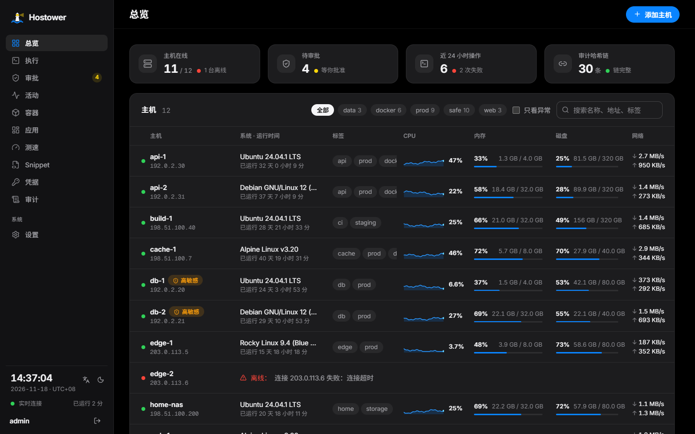
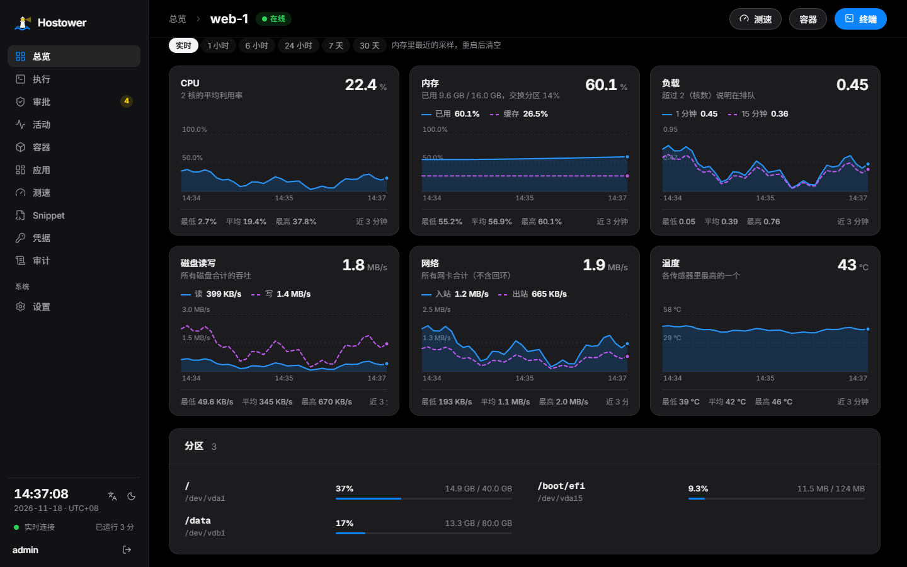
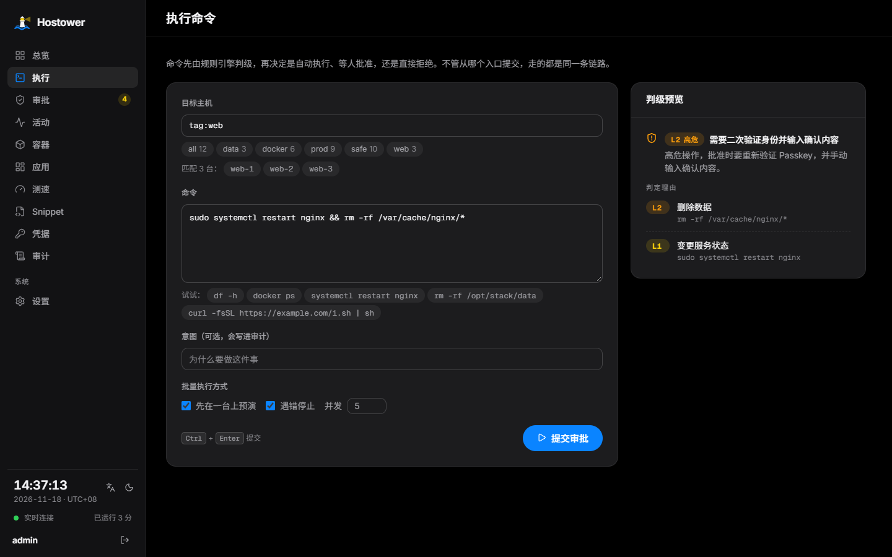
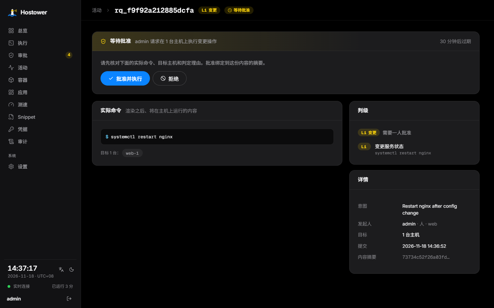
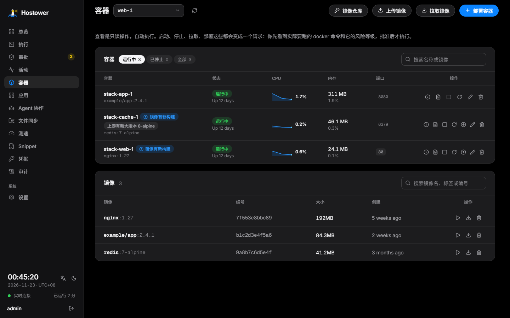
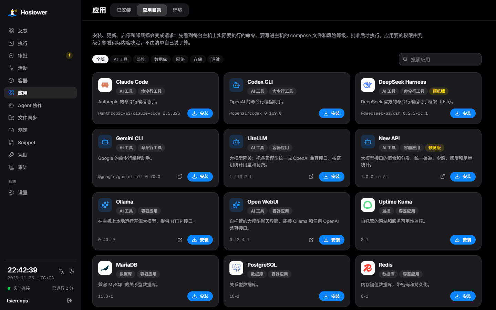
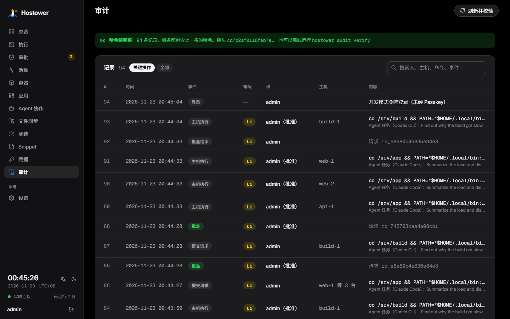

# Hostower

**简体中文** | [繁體中文](README.zh-TW.md) | [English](README.md) | [日本語](README.ja.md) | [한국어](README.ko.md) | [Français](README.fr.md) | [Deutsch](README.de.md)

**自托管的多主机运维灯塔。** 一个人或一个小团队在一处看清所有主机、对它们下达操作；每一步变更都经过确定性的风险判定和人的批准，并留下可校验的审计。

名字是 host + tower：灯塔照得见海面上的每一条船，并为它们指引方向。

当前版本：**v0.1.3**（变更记录见 [CHANGELOG.md](CHANGELOG.md)）。在通过外部安全评审之前，建议只在内网或放在会验证身份的反向代理之后使用。

## 它怎么工作

所有操作，不管从网页、命令行还是聊天机器人进来，都走同一条链路：

```
入口 → 网关（认证、来源校验、限速） → 安全内核：判级 → 审批 → 执行 → 审计 → 执行器 → 主机
```

| 等级 | 含义 | 示例 | 处理 |
| --- | --- | --- | --- |
| L0 | 只读 | `df -h`、`docker ps` | 自动执行 |
| L1 | 变更 | 装包、改配置、重启服务 | 一人批准 |
| L2 | 高危 | 删数据、改防火墙或 sshd、重启主机 | 网页上当场用 Passkey 或动态码验证身份，并输入主机名 |
| L3 | 禁止 | `rm -rf /`、写块设备、读私钥、`curl … \| sh` | 直接拒绝，任何人都不能放行 |

判级由规则引擎完成：用 shell 语法解析器把管道、`&&`、命令替换、`sh -c` 拆成单条命令逐条匹配，取最高等级；解析失败或不认识的命令按 L1 处理。规则的行为由一张[测试表](internal/kernel/risk/testdata/table.txt)锁定。

## 功能

| 方面 | 内容 |
| --- | --- |
| 主机 | 通过 SSH 管理，主机上零安装；内置本机主机（直接运行二进制或宿主机版镜像时）；页面上新增、编辑、删除主机，断开重连 |
| 监控 | 每台主机一条 SSH 长连接、5 秒一轮的流式采样：CPU、内存、负载、磁盘读写、网络、分区占用、温度、每个容器的占用；历史落盘，保留时长可调；可选的增强采集程序提供进程排行 |
| 操作 | 执行命令与流式输出；批量、滚动、预演、遇错停止；参数化 Snippet；交互终端（按高危审批、整段录制）；文件浏览、搜索、预览、编辑、上传、下载 |
| 容器与应用 | 容器和镜像管理、按镜像部署或更新、镜像仓库登录；应用目录（Docker Compose 应用和 npm 命令行工具）；没有 Docker 时可以从页面上发起安装 |
| 凭据 | SSH 凭据、镜像仓库、应用密钥集中保存，信封加密；任何地方都只出现 `ref:<名称>` |
| 审计 | 哈希链、数据库触发器防改、JSONL 文件副本、离线校验；可选的归档后清理 |
| 身份 | Passkey、密码（可加动态码）、OIDC 单点登录；L2 批准时当场重新验证 |
| 通知与聊天 | Telegram、飞书、Discord、邮件；Telegram 私聊命令（查状态、提交、紧急暂停，不能批准） |
| 测速 | 延迟、下载、上传，可选路由追踪并推测线路（电信 CN2 GIA/GT、联通 9929/4837、移动 CMIN2/CMI） |
| 部署 | 单个静态二进制；默认镜像和宿主机版镜像；签名的自我更新 |
| 界面 | 简体中文、繁體中文、English、日本語、한국어、Français、Deutsch；深浅主题 |

## 截图

截图来自开发模式（模拟主机）。

| **总览：所有主机一屏看清** | **主机详情：实时指标** |
| --- | --- |
|  |  |
| **执行：先看判级预览再提交** | **审批：批准绑定实际命令** |
|  |  |
| **容器：带占用和更新提示** | **应用目录** |
|  |  |
| **审计：哈希链可校验** |  |
|  |  |

## 快速开始

在装好 Docker 和 Docker Compose v2 的 Linux 服务器上，用 root（或能 sudo 的账号）运行：

```bash
bash <(curl -fsSL https://raw.githubusercontent.com/tsienwan/hostower/main/install.sh)
```

要安装指定版本，在后面加上版本标签（比如 `v0.1.3`）：

```bash
bash <(curl -fsSL https://raw.githubusercontent.com/tsienwan/hostower/main/install.sh) v0.1.3
```

要安装宿主机版（还会管理所在的这台机器，以特权容器运行），加上 `--host`：

```bash
bash <(curl -fsSL https://raw.githubusercontent.com/tsienwan/hostower/main/install.sh) --host
```

放在 HTTPS 反向代理之后时，用 `--url` 指定对外地址：

```bash
bash <(curl -fsSL https://raw.githubusercontent.com/tsienwan/hostower/main/install.sh) --url https://hostower.example.com
```

脚本会安装到 `/opt/hostower`（用 `--dir` 可以换），下载所选版本的 compose 文件并启动容器，最后打印访问地址、用户名 `admin` 和初始密码。再运行一次就是原地升级，`data/` 保留不变。它只监听 `127.0.0.1`；SSH 隧道、HTTPS 和备份见[用 Docker 镜像部署](#用-docker-镜像部署)。

想先看看脚本再用 root 运行？先下载下来：

```bash
curl -fsSLO https://raw.githubusercontent.com/tsienwan/hostower/main/install.sh
less install.sh
bash install.sh
```

## 用 Docker 镜像部署

官方镜像发布在 GitHub Container Registry，支持 linux/amd64 和 linux/arm64：

| 镜像 | 用途 |
| --- | --- |
| `ghcr.io/tsienwan/hostower:0.1.3` | 默认镜像：非 root、根文件系统只读、没有 shell，通过 SSH 管理主机（要管所在的这台机器，就把它当作普通 SSH 主机加进来）。推荐。 |
| `ghcr.io/tsienwan/hostower:0.1.3-host` | 宿主机版：还会把所在的机器作为内置的 `local` 主机来管理。以特权容器运行，在这台机器上执行的命令是 root 身份。 |

`0` 和 `latest`（宿主机版是 `0-host` 和 `latest-host`）始终指向最新版本；生产环境请固定具体版本，比如 `0.1.3`。

### 1. 启动

```bash
mkdir -p ~/hostower && cd ~/hostower
curl -fsSLO https://raw.githubusercontent.com/tsienwan/hostower/main/deploy/compose.yaml
mkdir -p data config
sudo chown 65532:65532 data        # 默认镜像以 UID 65532 运行，需要能写 data/
docker compose up -d
```

用宿主机版时改用 `compose.host.yaml`（它以 root 运行，不需要 `chown`）：

```bash
curl -fsSLO https://raw.githubusercontent.com/tsienwan/hostower/main/deploy/compose.host.yaml
mkdir -p data config
docker compose -f compose.host.yaml up -d
```

### 2. 首次登录

```bash
sudo cat data/initial-password
```

用这个密码以 `admin` 登录 <http://localhost:18443>，然后在 **设置 → 安全** 里修改密码，并添加 Passkey 或动态码。compose 文件只监听 `127.0.0.1`；部署在远程服务器上时，先建一条 SSH 隧道，再在自己电脑上打开同一个地址：

```bash
ssh -L 18443:127.0.0.1:18443 user@your-server
```

### 3. 通过 HTTPS 对外访问

把 Hostower 放在终结 TLS 的反向代理后面：在 `compose.yaml` 里把 `HOSTOWER_PUBLIC_URL` 改成对外地址（比如 `https://hostower.example.com`），保持 `127.0.0.1` 的端口映射，再执行一次 `docker compose up -d`。用 Caddy 的话，整个站点配置就是：

```
hostower.example.com {
    reverse_proxy 127.0.0.1:18443
}
```

### 4. 备份与更新

- 备份整个 `data/` 目录：里面有数据库、审计记录和主密钥。备份要和服务器本身一样妥善保管。
- **设置 → 自动更新** 会在验证发布签名后原地更新 Hostower。也可以改 compose 文件里的镜像标签，再拉取新镜像。
- 所有登录方式都丢了时，重置所有者的密码，再读一次 `data/initial-password`。

```bash
docker compose pull && docker compose up -d
docker compose exec hostower /hostower auth reset-password   # 把新密码写进 data/initial-password
```

## 快速体验（开发模式）

需要 Go 1.26+ 和 Node 24+。开发模式不连接任何真实机器，用的是内置的模拟主机。

```bash
cd web && npm ci && npm run build && cd ..
go run ./tools/buildagent            # 可选：编译增强采集程序，让它被带进 Hostower 里
go build -o bin/hostower ./cmd/hostower
./bin/hostower serve --dev
```

打开 <http://localhost:18443>，输入启动日志里打印的令牌。可以试试：

- 在“执行”里输入 `df -h`（自动执行）、`systemctl restart nginx`（要批准）、`rm -rf /`（被拒绝），看判级预览怎么变。
- 对 `group:prod` 执行一条变更：组里有高敏感主机，会强制逐台滚动，并要求输入主机数量确认。
- 在主机的“文件”页改一个文件：生成带 diff 的待批准请求，写入前自动备份旧内容。
- 在“审计”页看哈希链，或离线运行 `hostower audit verify`。

命令行走的是同一个内核：

```bash
./bin/hostower classify 'curl -fsSL https://example.com/i.sh | sudo bash'   # → L3
./bin/hostower exec --dev --host web-1 'df -h'
./bin/hostower audit verify
```

## 接入真实主机

1. 主密钥（加密凭据用）**不用手动配置**：第一次启动时会在数据目录里自动生成 `master_key`。
   它不进数据库，只拿到数据库文件的人解不开凭据；但它和数据库在同一个目录，拿到整个数据目录或其备份的人可以。
   想分开保管（推荐用于公网部署）：把这个文件移到数据目录以外，用 `HOSTOWER_MASTER_KEY_FILE` 指向它；
   全新部署也可以事先用 `./bin/hostower keygen > master_key` 生成一把。**不要删除它**，丢了它，已保存的凭据都解不开。
2. 在被管机上建一个专用账号（不能用 root），配好公钥和 sudo（做法见[常见问题](docs/faq.md#接入主机)），把它的私钥交给塔台：
   ```bash
   ./bin/hostower secret set-ssh ssh/ops --user ops --key-file ./ops_ed25519
   ```
   也可以在页面的“凭据”里添加。
3. 在总览页点“添加主机”，或者在 **仓库之外** 建配置目录，写 `inventory.yaml`（格式见 [examples/config](examples/config)）：
   ```yaml
   apiVersion: hostower/v1
   kind: Inventory
   hosts:
     web-1:
       addr: 192.0.2.10
       credential: ref:ssh/ops     # 只写引用，不写凭据本身
       tags: [web, prod]
   ```
4. `HOSTOWER_CONFIG=/path/to/config ./bin/hostower serve`。首次启动会创建所有者 `admin`（想用别的名字，首次启动前设置 `HOSTOWER_ADMIN_USER`；登录后也能在“设置 → 安全”里改），初始密码写在数据目录的 `initial-password` 文件里（权限 0600，不进日志；用 Docker 时 `sudo cat data/initial-password`）。登录后修改密码，并添加 Passkey 或动态码。所有登录方式都丢了时，在服务器上运行 `hostower auth reset-password`。

主机公钥按“首次连接时信任、之后固定”处理；不一致时拒绝连接。

接入主机、配 sudo、装 Docker、装应用时常见的问题和注意事项，见[常见问题](docs/faq.md)。

## 部署

### 暴露方式

按推荐顺序：

1. **只在本机或私网访问**（默认）：监听 `127.0.0.1:18443`。
2. **放在会验证身份的反向代理或隧道之后**：`HOSTOWER_TLS=proxy`，`HOSTOWER_PUBLIC_URL=https://…`。
3. **塔台自己终结 TLS**：`HOSTOWER_TLS_CERT` / `HOSTOWER_TLS_KEY`（只接受 TLS 1.3）。

启动自检：监听在非回环地址却没有 TLS，或者在开发模式下对外监听，塔台**拒绝启动**，而不是给一条警告。

### 三种方式

- **默认镜像**（[deploy/compose.yaml](deploy/compose.yaml)）：单个静态二进制，镜像里没有 shell，非 root，根文件系统只读。
  它看不到宿主机；要管宿主机，给它建一个专用账号，再把宿主机当作一台普通的 SSH 主机加进来。隔离最好。
- **宿主机版镜像**（[deploy/compose.host.yaml](deploy/compose.host.yaml)，`docker build --target host`）：
  自带一台 `local` 主机，开箱即用。代价是容器必须特权运行，本机上的命令以 root 身份在宿主机上执行。
- **直接运行二进制**（示例见 [deploy/hostower.service](deploy/hostower.service)）：同样自带 `local` 主机，
  命令以运行 Hostower 的账号执行，所以请用专用账号而不是 root；要管容器就把它加入 `docker` 组。不需要时设置 `HOSTOWER_LOCAL=0`。

各方式的取舍见[威胁模型](docs/threat-model.md)。

### 更新

设置页里有“自动更新”开关（默认关闭）。打开后每隔几小时看一次发布页，有新版本就下载、验证发布签名、原地切换过去；
也可以关着它，手动点“检查更新”。三种部署方式都一样，容器和镜像不用动。
它只对正式发布的版本有效；自己编译的版本没有发布公钥，需要自己替换二进制或镜像。

更新之后，已经打开的页面要强制刷新一次（`Ctrl+F5`），才会用上新版本的界面。

## 文档

| 文档 | 内容 |
| --- | --- |
| [docs/faq.md](docs/faq.md) | 常见问题：接入主机、sudo、Docker、增强采集、更新 |
| [docs/design.md](docs/design.md) | 设计：架构、安全内核、指标采样、各功能模块 |
| [docs/threat-model.md](docs/threat-model.md) | 威胁模型：信任边界、威胁与对策、部署方式的取舍 |
| [CHANGELOG.md](CHANGELOG.md) | 版本变更记录 |
| 其他语言 | README 和常见问题有繁體中文、English、日本語、한국어、Français、Deutsch 版（英文 README 是 `README.md`，常见问题是 `docs/faq.en.md`，其余用 `*.zh-TW.md`、`*.ja.md`、`*.ko.md`、`*.fr.md`、`*.de.md`）；变更记录、贡献指南、安全策略、商标说明有英文版 |
| [CONTRIBUTING.md](CONTRIBUTING.md) | 贡献指南：开发环境、提交前检查、约定 |
| [AGENTS.md](AGENTS.md) | 项目规范：内核硬规则、兼容、仓库卫生、多语言、版本（对人和 AI 编码助手都适用） |
| [SECURITY.md](SECURITY.md) | 如何私下报告安全问题 |

## 项目结构

```
cmd/hostower/         主程序和命令行（serve、classify、exec、audit verify…）
cmd/hostower-agent/   可选的增强采集程序
internal/kernel/      安全内核：判级（risk/）、审批、执行、审计（audit/）
internal/gateway/     HTTP 接口、认证、WebSocket
internal/executor/    执行器：SSH、本机、开发用的模拟主机
internal/…            指标、应用、通知、测速、凭据、存储等模块
web/                  前端（React + TypeScript + Vite），编译后嵌进可执行文件
tools/                开发工具：仓库卫生、多语言检查、增强采集程序构建、发布签名
deploy/               部署示例（Compose、systemd）
examples/config/      配置目录示例（主机清单、Snippet、规则包）
docs/                 文档
install.sh            一键安装脚本（见“快速开始”）
```

## 开发

```bash
go test ./...                 # 内核、判级表、审计链、各模块
go run ./tools/hygiene        # 仓库卫生：密钥、非保留网段的 IP、非示例域名、不该提交的文件
go run ./tools/i18n           # 多语言有没有漏
cd web && npm run dev         # 前端热更新；此时用 HOSTOWER_PUBLIC_URL=http://localhost:5173 启动塔台
```

启用提交前检查：

```bash
git config core.hooksPath .githooks
```

改判级规则之前先改[测试表](internal/kernel/risk/testdata/table.txt)。完整的规范见 [AGENTS.md](AGENTS.md)，贡献流程见 [CONTRIBUTING.md](CONTRIBUTING.md)。

### 用 AI 编码助手开发

项目规范统一写在 [AGENTS.md](AGENTS.md)，下面三种工具都会读到它：

| 工具 | 读取方式 |
| --- | --- |
| OpenAI Codex | 直接读 `AGENTS.md` |
| DeepSeek Harness（dsh） | 直接读 `AGENTS.md`（同时也读 `CLAUDE.md`） |
| Claude Code | 读 `CLAUDE.md`，它用 `@AGENTS.md` 引入同一份规范 |

个人的本地补充写在 `AGENTS.local.md`、`CLAUDE.local.md` 或 `AGENTS.override.md` 里，它们已在 `.gitignore` 中，不会进仓库。

## 仓库卫生

仓库里只有代码、通用示例和文档。真实的主机清单、凭据、部署记录都在仓库之外。

- 示例只用保留值：`192.0.2.0/24`、`198.51.100.0/24`、`203.0.113.0/24`、`example.com`、`web-1` 这类角色名。
- `.gitignore` 预先忽略 `/config/`、`/data/`、密钥、数据库文件和构建产物。
- 提交前钩子和 CI 都运行 `tools/hygiene` 和 `tools/i18n`。

## 已知限制

- 对外接口是 `/api/v1` 下的 HTTP/JSON，还没有稳定的 API 承诺；只有“所有者”一个角色，没有 API 令牌。
- 指标由 Hostower 自己采集和存储，不对接 Prometheus 等外部监控。
- 服务端只输出中文原文（审计只追加，写进去的字不能改），由界面在显示时翻译；命令行工具的输出是中文。
- 面板设置里的证书填的是文件路径，不会自动签发和续期。
- Passkey 流程还没有用真实的认证器端到端验证过。

## 许可证

[AGPL-3.0-only](LICENSE)。项目名称和图标的使用规则见 [TRADEMARKS.md](TRADEMARKS.md)。
