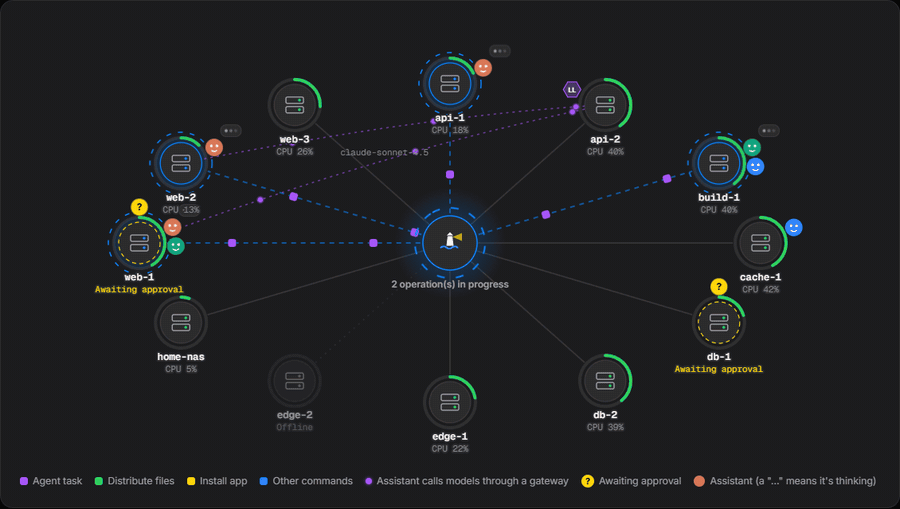
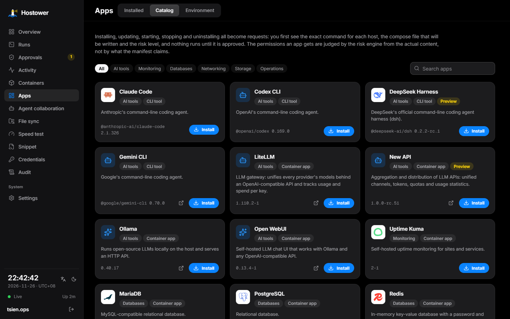
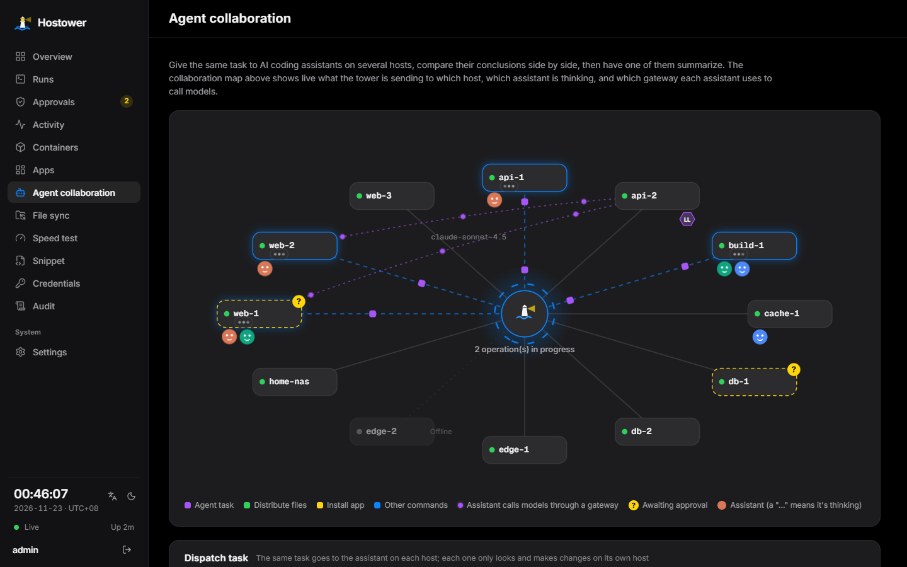
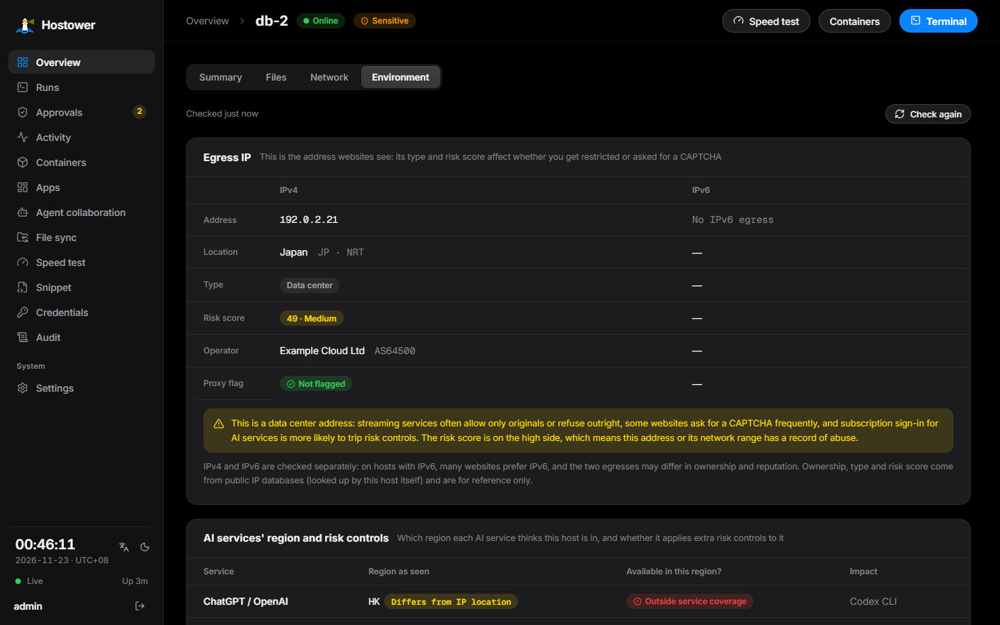
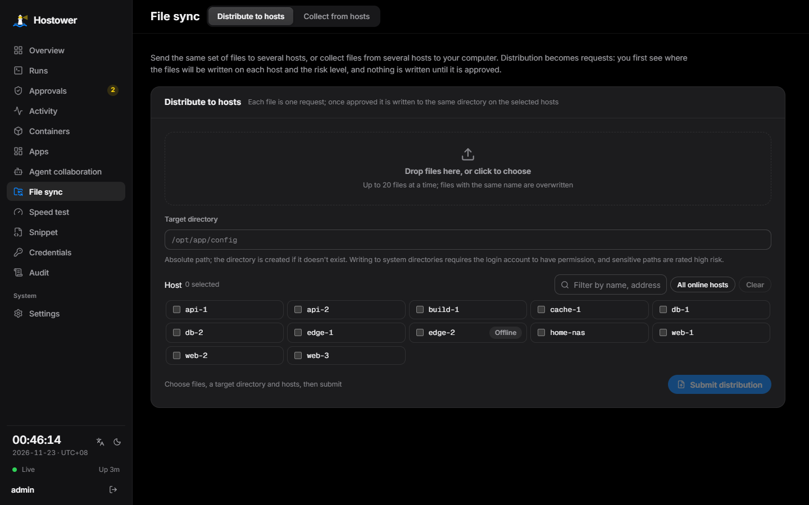

# Hostower

[简体中文](README.zh-CN.md) | **繁體中文** | [English](README.md) | [日本語](README.ja.md) | [한국어](README.ko.md) | [Français](README.fr.md) | [Deutsch](README.de.md)

**自行託管的多主機維運燈塔。** 一個人或一個小團隊在同一處看清所有主機、對它們下達操作；每一步變更都經過確定性的風險判定和人工核准，並留下可驗證的稽核紀錄。



主機上的 AI 程式設計助手也守同樣的規矩：每個任務都要判級、由人核准、記入稽核。

名字是 host + tower：燈塔照得見海面上的每一艘船，並為它們指引方向。

目前版本：**v0.5.7**（變更紀錄見 [CHANGELOG.md](CHANGELOG.md)）。在通過外部安全審查之前，建議只在內網或放在會驗證身分的反向代理之後使用。

## 它怎麼運作

所有操作，不管從網頁、命令列、聊天機器人還是 MCP 用戶端進來，都走同一條鏈路：

```
入口 → 閘道（認證、來源驗證、限速） → 安全核心：判級 → 核准 → 執行 → 稽核 → 執行器 → 主機
```

| 等級 | 意義 | 範例 | 處理 |
| --- | --- | --- | --- |
| L0 | 唯讀 | `df -h`、`docker ps` | 自動執行 |
| L1 | 變更 | 安裝套件、修改設定、重新啟動服務 | 一人核准 |
| L2 | 高風險 | 刪除資料、修改防火牆或 sshd、重新啟動主機 | 在網頁上當場用 Passkey 或動態驗證碼驗證身分，並輸入主機名稱 |
| L3 | 禁止 | `rm -rf /`、寫入區塊裝置、讀取私鑰、`curl … \| sh` | 直接拒絕，任何人都不能放行 |

判級由規則引擎完成：用 shell 語法剖析器把管線、`&&`、命令替換、`sh -c` 拆成單條命令逐條比對，取最高等級；剖析失敗或不認得的命令按 L1 處理。規則的行為由一張[測試表](internal/kernel/risk/testdata/table.txt)鎖定。

## 功能

| 面向 | 內容 |
| --- | --- |
| 主機 | 透過 SSH 管理，主機上零安裝；內建本機主機（直接執行二進位檔或宿主機版映像檔時）；在頁面上新增、編輯、刪除主機，中斷後重新連線 |
| 監控 | 每台主機一條 SSH 長連線、每 5 秒一輪的串流取樣：CPU、記憶體、負載、磁碟讀寫、網路、分割區使用量、溫度、每個容器的資源使用量；歷史資料寫入磁碟，保留時長可調；可選的增強採集程式提供處理程序排行 |
| 操作 | 執行命令並串流輸出；批次、輪流、預演、遇錯停止；參數化 Snippet；互動終端機（按高風險核准、全程錄製）；檔案瀏覽、搜尋、預覽、編輯、上傳、下載；把檔案分發到多台主機，按檔名規則從多台主機收集檔案 |
| 容器與應用 | 容器和映像檔管理、按映像檔部署或更新、映像檔倉庫登入；應用目錄（Docker Compose 應用和 npm 命令列工具，含 OpenList、LiteLLM、Open WebUI、Ollama 等），安裝好後給出存取位址、初始帳號和上手步驟；偵測每台主機的出口 IP（IPv4 和 IPv6 分開）類型和風險分數、AI 服務把它當成哪個區和風險控管訊號、能不能用 OpenAI、Claude、Gemini 等模型介面、Google、YouTube、Netflix 等網站能不能開啟和在哪個區、安裝了哪些 AI 命令列工具；沒有 Docker 時可以從頁面上發起安裝 |
| Agent 協作 | 把同一個任務派給多台主機上的 Claude Code、Codex CLI、Gemini CLI，並排比較結果，再讓其中一個彙整；協作圖即時顯示下發的操作、正在思考的助手和經由閘道的模型呼叫 |
| MCP 入口 | Claude Code、Codex 這類 AI 助手用所有者簽發的權杖透過 MCP 連進來：列主機、看指標、預估等級、提交指令、查結果；請求照常判級，L1、L2 由人在網頁上核准，AI 不能核准 |
| 憑據 | SSH 憑據、映像檔倉庫、應用密鑰集中保存，以信封加密；任何地方都只出現 `ref:<名稱>` |
| 稽核 | 雜湊鏈、資料庫觸發器防竄改、JSONL 檔案副本、離線驗證；可選的封存後清理 |
| 身分 | Passkey、密碼（可加動態驗證碼）、OIDC 單一登入；L2 核准時當場重新驗證 |
| 通知與聊天 | Telegram、飛書、Discord、電子郵件；離線、流量、磁碟、記憶體、CPU 告警和恢復通知；Telegram 私訊命令（查詢狀態、提交、緊急暫停，不能核准） |
| 測速 | 延遲、下載、上傳，可選路由追蹤並推測線路（電信 CN2 GIA/GT、聯通 9929/4837、移動 CMIN2/CMI） |
| 部署 | 單一靜態二進位檔；預設映像檔和宿主機版映像檔；經簽章的自我更新 |
| 介面 | 简体中文、繁體中文、English、日本語、한국어、Français、Deutsch；深淺色主題 |

## 截圖

截圖來自開發模式（模擬主機），介面為英文。

| **總覽：所有主機一屏看清** | **主機詳情：即時指標** |
| --- | --- |
|  |  |
| **執行：先看等級判定預覽再提交** | **核准：核准綁定實際指令** |
|  |  |
| **容器：附資源占用與更新提示** | **應用程式目錄** |
|  |  |
| **稽核：雜湊鏈可校驗** | **Agent 協作：協作圖即時顯示誰在做事** |
|  |  |
| **環境偵測：出口 IP、AI 服務的地區與風險控管** | **檔案同步：分發到多台主機、從多台主機收集** |
|  |  |

## 快速開始

在裝好 Docker 與 Docker Compose v2 的 Linux 伺服器上，以 root（或能 sudo 的帳號）執行：

```bash
bash <(curl -fsSL https://raw.githubusercontent.com/tsienwan/hostower/main/install.sh)
```

要安裝指定版本，在後面加上版本標籤（例如 `v0.5.7`）：

```bash
bash <(curl -fsSL https://raw.githubusercontent.com/tsienwan/hostower/main/install.sh) v0.5.7
```

要安裝宿主機版（還會管理所在的這台機器，以特權容器執行），加上 `--host`：

```bash
bash <(curl -fsSL https://raw.githubusercontent.com/tsienwan/hostower/main/install.sh) --host
```

放在 HTTPS 反向代理後面時，用 `--url` 指定對外位址：

```bash
bash <(curl -fsSL https://raw.githubusercontent.com/tsienwan/hostower/main/install.sh) --url https://hostower.example.com
```

腳本會安裝到 `/opt/hostower`（用 `--dir` 可以更換），下載所選版本的 compose 檔並啟動容器，最後列出存取位址、使用者名稱 `admin` 和初始密碼。再執行一次就是原地升級，`data/` 保留不變。它只監聽 `127.0.0.1`；SSH 通道、HTTPS 與備份請見[使用 Docker 映像檔部署](#使用-docker-映像檔部署)。

想先看過腳本再用 root 執行？先下載下來：

```bash
curl -fsSLO https://raw.githubusercontent.com/tsienwan/hostower/main/install.sh
less install.sh
bash install.sh
```

## 使用 Docker 映像檔部署

官方映像檔發布在 GitHub Container Registry，支援 linux/amd64 與 linux/arm64：

| 映像檔 | 用途 |
| --- | --- |
| `ghcr.io/tsienwan/hostower:0.5.7` | 預設映像檔：非 root、根檔案系統唯讀、沒有 shell，透過 SSH 管理主機（要管理所在的這台機器，就把它當作一般 SSH 主機加進來）。建議使用。 |
| `ghcr.io/tsienwan/hostower:0.5.7-host` | 宿主機版：還會把所在的機器當作內建的 `local` 主機來管理。以特權容器執行，在這台機器上執行的指令是 root 身分。 |

`0` 和 `latest`（宿主機版是 `0-host` 和 `latest-host`）一律指向最新版本；正式環境請固定具體版本，例如 `0.5.7`。

### 1. 啟動

```bash
mkdir -p ~/hostower && cd ~/hostower
curl -fsSLO https://raw.githubusercontent.com/tsienwan/hostower/main/deploy/compose.yaml
mkdir -p data config
sudo chown 65532:65532 data        # 預設映像檔以 UID 65532 執行，需要能寫入 data/
docker compose up -d
```

使用宿主機版時改用 `compose.host.yaml`（它以 root 執行，不需要 `chown`）：

```bash
curl -fsSLO https://raw.githubusercontent.com/tsienwan/hostower/main/deploy/compose.host.yaml
mkdir -p data config
docker compose -f compose.host.yaml up -d
```

### 2. 首次登入

```bash
sudo cat data/initial-password
```

用這組密碼以 `admin` 登入 <http://localhost:18443>，然後在 **設定 → 安全** 裡修改密碼，並新增 Passkey 或動態驗證碼。compose 檔只監聽 `127.0.0.1`；部署在遠端伺服器時，先建立一條 SSH 通道，再在自己的電腦上開啟同一個位址：

```bash
ssh -L 18443:127.0.0.1:18443 user@your-server
```

### 3. 透過 HTTPS 對外提供

把 Hostower 放在終結 TLS 的反向代理後面：在 `compose.yaml` 裡把 `HOSTOWER_PUBLIC_URL` 改成對外位址（例如 `https://hostower.example.com`），保持 `127.0.0.1` 的連接埠對應，再執行一次 `docker compose up -d`。使用 Caddy 的話，整個網站設定就是：

```
hostower.example.com {
    reverse_proxy 127.0.0.1:18443
}
```

### 4. 備份與更新

- 備份整個 `data/` 目錄：裡面有資料庫、稽核紀錄和主金鑰。備份要和伺服器本身一樣妥善保管。
- **設定 → 自動更新** 會在驗證發布簽章後原地更新 Hostower。也可以修改 compose 檔裡的映像檔標籤，再拉取新映像檔。
- 所有登入方式都遺失時，重設擁有者的密碼，再讀一次 `data/initial-password`。

```bash
docker compose pull && docker compose up -d
docker compose exec hostower /hostower auth reset-password   # 把新密碼寫進 data/initial-password
```

## 快速體驗（開發模式）

需要 Go 1.26+ 和 Node 24+。開發模式不連接任何真實機器，用的是內建的模擬主機。

```bash
cd web && npm ci && npm run build && cd ..
go run ./tools/buildagent            # 可選：編譯增強採集程式，讓它被打包進 Hostower 裡
go build -o bin/hostower ./cmd/hostower
./bin/hostower serve --dev
```

開啟 <http://localhost:18443>，輸入啟動日誌裡印出的權杖。可以試試：

- 在「執行」裡輸入 `df -h`（自動執行）、`systemctl restart nginx`（需要核准）、`rm -rf /`（被拒絕），看等級判定預覽怎麼變。
- 對 `group:prod` 執行一條變更：群組裡有高敏感主機，會強制逐台輪流執行，並要求輸入主機數量確認。
- 在主機的「檔案」頁修改一個檔案：產生附帶 diff 的待核准請求，寫入前自動備份舊內容。
- 在「稽核」頁查看雜湊鏈，或離線執行 `hostower audit verify`。

命令列走的是同一個核心：

```bash
./bin/hostower classify 'curl -fsSL https://example.com/i.sh | sudo bash'   # → L3
./bin/hostower exec --dev --host web-1 'df -h'
./bin/hostower audit verify
```

## 接入真實主機

1. 主金鑰（加密憑據用）**不需手動設定**：第一次啟動時會在資料目錄裡自動產生 `master_key`。
   它不進資料庫，只取得資料庫檔案的人解不開憑據；但它和資料庫在同一個目錄，取得整個資料目錄或其備份的人可以。
   想分開保管（建議用於公網部署）：把這個檔案移到資料目錄以外，用 `HOSTOWER_MASTER_KEY_FILE` 指向它；
   全新部署也可以事先用 `./bin/hostower keygen > master_key` 產生一把。**不要刪除它**，遺失它，已儲存的憑據都解不開。
2. 在受管主機上建立一個專用帳號（不能用 root），設定好公鑰和 sudo（做法見[常見問題](docs/faq.zh-TW.md#接入主機)），把它的私鑰交給塔台：
   ```bash
   ./bin/hostower secret set-ssh ssh/ops --user ops --key-file ./ops_ed25519
   ```
   也可以在頁面的「憑據」裡新增。
3. 在總覽頁點「新增主機」，或者在 **儲存庫之外** 建立設定目錄，寫 `inventory.yaml`（格式見 [examples/config](examples/config)）：
   ```yaml
   apiVersion: hostower/v1
   kind: Inventory
   hosts:
     web-1:
       addr: 192.0.2.10
       credential: ref:ssh/ops     # 只寫引用，不寫憑據本身
       tags: [web, prod]
   ```
4. `HOSTOWER_CONFIG=/path/to/config ./bin/hostower serve`。首次啟動會建立擁有者 `admin`（想用別的名稱，在首次啟動前設定 `HOSTOWER_ADMIN_USER`；登入後也能在「設定 → 安全」裡修改），初始密碼寫在資料目錄的 `initial-password` 檔案裡（權限 0600，不進日誌；使用 Docker 時 `sudo cat data/initial-password`）。登入後修改密碼，並新增 Passkey 或動態驗證碼。所有登入方式都遺失時，在伺服器上執行 `hostower auth reset-password`。

主機公鑰按「首次連線時信任、之後固定」處理；不一致時拒絕連線。

接入主機、設定 sudo、安裝 Docker、安裝應用時常見的問題和注意事項，見[常見問題](docs/faq.zh-TW.md)。

## 部署

### 對外開放方式

按建議順序：

1. **只在本機或私有網路存取**（預設）：監聽 `127.0.0.1:18443`。
2. **放在會驗證身分的反向代理或通道之後**：`HOSTOWER_TLS=proxy`，`HOSTOWER_PUBLIC_URL=https://…`。
3. **塔台自己終結 TLS**：`HOSTOWER_TLS_CERT` / `HOSTOWER_TLS_KEY`（只接受 TLS 1.3）。

啟動自我檢查：監聽在非迴路位址卻沒有 TLS，或者在開發模式下對外監聽，塔台**拒絕啟動**，而不是只給一條警告。

### 三種方式

- **預設映像檔**（[deploy/compose.yaml](deploy/compose.yaml)）：單一靜態二進位檔，映像檔裡沒有 shell，非 root，根檔案系統唯讀。
  它看不到宿主機；要管理宿主機，就為它建立一個專用帳號，再把宿主機當作一台普通的 SSH 主機加進來。隔離最好。
- **宿主機版映像檔**（[deploy/compose.host.yaml](deploy/compose.host.yaml)，`docker build --target host`）：
  內建一台 `local` 主機，開箱即用。代價是容器必須以特權模式執行，本機上的命令以 root 身分在宿主機上執行。
- **直接執行二進位檔**（範例見 [deploy/hostower.service](deploy/hostower.service)）：同樣內建 `local` 主機，
  命令以執行 Hostower 的帳號執行，所以請用專用帳號而不是 root；要管理容器就把它加入 `docker` 群組。不需要時設定 `HOSTOWER_LOCAL=0`。

各方式的取捨見[威脅模型](docs/threat-model.md)。

### 更新

設定頁裡有「自動更新」開關（預設關閉）。開啟後每隔幾小時查看一次發行頁面，有新版本就下載、驗證發行簽章、原地切換過去；
也可以保持關閉，手動點「檢查更新」。三種部署方式都一樣，容器和映像檔不用動。
它只對正式發行的版本有效；自行編譯的版本沒有發行公鑰，需要自己替換二進位檔或映像檔。

更新之後，已經開啟的頁面要強制重新整理一次（`Ctrl+F5`），才會用上新版本的介面。

## 文件

| 文件 | 內容 |
| --- | --- |
| [docs/faq.zh-TW.md](docs/faq.zh-TW.md) | 常見問題：接入主機、sudo、Docker、增強採集、更新 |
| [docs/design.md](docs/design.md) | 設計：架構、安全核心、指標取樣、各功能模組 |
| [docs/threat-model.md](docs/threat-model.md) | 威脅模型：信任邊界、威脅與對策、部署方式的取捨 |
| [CHANGELOG.md](CHANGELOG.md) | 版本變更紀錄 |
| [README.en.md](README.md) 等 `*.en.md` | README、常見問題、變更紀錄、貢獻指南、安全政策、商標說明的英文版 |
| [CONTRIBUTING.md](CONTRIBUTING.md) | 貢獻指南：開發環境、提交前檢查、慣例 |
| [AGENTS.md](AGENTS.md) | 專案規範：核心硬規則、相容性、儲存庫衛生、多語言、版本（對人和 AI 程式設計助手都適用） |
| [SECURITY.md](SECURITY.md) | 如何私下回報安全問題 |

## 專案結構

```
cmd/hostower/         主程式和命令列（serve、classify、exec、audit verify…）
cmd/hostower-agent/   可選的增強採集程式
internal/kernel/      安全核心：判級（risk/）、核准、執行、稽核（audit/）
internal/gateway/     HTTP 介面、認證、WebSocket
internal/executor/    執行器：SSH、本機、開發用的模擬主機
internal/…            指標、應用、通知、測速、憑據、儲存等模組
web/                  前端（React + TypeScript + Vite），編譯後嵌入執行檔
tools/                開發工具：儲存庫衛生、多語言檢查、增強採集程式建置、發行簽章
deploy/               部署範例（Compose、systemd）
examples/config/      設定目錄範例（主機清單、Snippet、規則包）
docs/                 文件
install.sh            一鍵安裝腳本（見「快速開始」）
```

## 開發

```bash
go test ./...                 # 核心、判級表、稽核鏈、各模組
go run ./tools/hygiene        # 儲存庫衛生：金鑰、非保留網段的 IP、非範例網域、不該提交的檔案
go run ./tools/i18n           # 多語言有沒有遺漏
cd web && npm run dev         # 前端熱更新；此時用 HOSTOWER_PUBLIC_URL=http://localhost:5173 啟動塔台
```

啟用提交前檢查：

```bash
git config core.hooksPath .githooks
```

修改判級規則之前先改[測試表](internal/kernel/risk/testdata/table.txt)。完整的規範見 [AGENTS.md](AGENTS.md)，貢獻流程見 [CONTRIBUTING.md](CONTRIBUTING.md)。

### 用 AI 程式設計助手開發

專案規範統一寫在 [AGENTS.md](AGENTS.md)，下面三種工具都會讀到它：

| 工具 | 讀取方式 |
| --- | --- |
| OpenAI Codex | 直接讀 `AGENTS.md` |
| DeepSeek Harness（dsh） | 直接讀 `AGENTS.md`（同時也讀 `CLAUDE.md`） |
| Claude Code | 讀 `CLAUDE.md`，它用 `@AGENTS.md` 引入同一份規範 |

個人的本機補充寫在 `AGENTS.local.md`、`CLAUDE.local.md` 或 `AGENTS.override.md` 裡，它們已列在 `.gitignore` 中，不會進入儲存庫。

## 儲存庫衛生

儲存庫裡只有程式碼、通用範例和文件。真實的主機清單、憑據、部署紀錄都在儲存庫之外。

- 範例只用保留值：`192.0.2.0/24`、`198.51.100.0/24`、`203.0.113.0/24`、`example.com`、`web-1` 這類角色名稱。
- `.gitignore` 預先忽略 `/config/`、`/data/`、金鑰、資料庫檔案和建置產物。
- 提交前鉤子和 CI 都會執行 `tools/hygiene` 和 `tools/i18n`。

## 已知限制

- 對外介面是 `/api/v1` 下的 HTTP/JSON，還沒有穩定的 API 承諾；只有「擁有者」一個角色，沒有 API 權杖。
- 指標由 Hostower 自己採集和儲存，不對接 Prometheus 等外部監控。
- 伺服器端只輸出中文原文（稽核只追加，寫進去的字不能改），由介面在顯示時翻譯；命令列工具的輸出是中文。
- 面板設定裡的憑證填的是檔案路徑，不會自動簽發和續期。
- Passkey 流程還沒有用真實的驗證器做過端對端驗證。

## 授權條款

[AGPL-3.0-only](LICENSE)。專案名稱和圖示的使用規則見 [TRADEMARKS.md](TRADEMARKS.md)。
